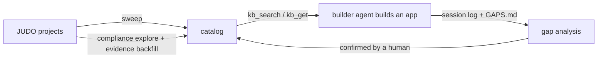

# JUDO Blueprint

> **Note for agents:** if `kb_search` returned this README, the kb settings index too much. Add `README.md` (and, if present, `.pi/skills/**`, `openspec/**`) to the `exclude` list in `.pi/dashboard/knowledge_base.json`, or index only `catalog/`. This file describes the repository; it is not catalog knowledge.

The JUDO catalog: platform documentation, model blueprints and best practices for building JUDO applications. It is made to be searched by the pi kb (`kb_search`, `kb_get`), and it ships pi skills that use, diagram, author and grow it.

## What this project is

JUDO generates a full application (database, OSGi backend on Karaf, React frontend, Keycloak) from a model. Building real applications on it needs knowledge the generator does not give you: how the platform really behaves, which model shapes work, and which coding practices hold up. This repository collects that knowledge in one searchable catalog:

- **Platform facts** (`agent-docs/`) are the source of truth. Every other entry must agree with them; where they are silent, an entry says *verify*.
- **Model blueprints** and **best practices** are mined from real JUDO projects. Each entry is written generically: the reusable mechanism with neutral names (`Order`, `Product`, `WorkOrder`). The projects it was seen in appear only as metadata (`projects:`, `evidence:` with real file paths, `project:` tags), never in the text.
- **Diagrams** are generated from small validated JUDO models (`fragments/`), so every model shape is known to be valid.
- **Status** follows evidence: `single-project` (1 project), `emerging` (2 to 3), `established` (4 or more).

The catalog is tested by use: an agent builds a real application with only the catalog as knowledge, and the gaps it hits are mined back into the catalog (see `judo-catalog-expand`).

## What's inside

```
catalog/                       the kb source (consumers index only this folder)
  agent-docs/                  platform behaviour and rules (83 docs)
    model/ backend/ frontend/ deployment/ integration-testing/ e2e-testing/
  model-blueprints/<id>/       110 reusable model shapes
    BLUEPRINT.md               intent, structure, constraints, variations, when to use/avoid
    model.md                   model shape + generated Mermaid diagram
    backend.md frontend.md     layer guidance
  best-practices/<domain>/     250 practices: model 77, backend 94, frontend 74,
                               project 5 (repository layout)
fragments/<id>.model           156 validated fragment models behind the diagrams
skills/                        pi skills shipped to consumers and authors
.pi/skills/                    maintainer skills and data (not indexed by kb)
  judo-catalog-maintain/references/PROJECTS.md   registry of source projects (swept SHA, weight)
  judo-catalog-expand/         workflows that grow the catalog with background agents
openspec/                      change proposals, specs and working records
target/                        ignored: CLI jar, project snapshots, agent work files
```

Every directory under `catalog/` has a generated `AGENTS.md` index (`| File | Purpose |`), and parent indexes list their subfolders.



## Use it in a project

1. Install the skills: `pi install` this package at a release tag.
2. Add the catalog as a pinned kb source:

   ```bash
   skills/judo-blueprint/scripts/pin-source <tag> --project /path/to/project
   ```

   This writes a `git` source with `pin: <tag>` and `subdir: catalog` into the project's `.pi/dashboard/knowledge_base.json`. Reload the kb afterwards. Pin a tag or SHA, never a branch.
3. Ask with domain words; the `judo-blueprint` skill explains search and apply.

## Contribute: your own project branch

The catalog grows from use. Each JUDO project works on its own branch, `project/<project-id>`, created from `develop`, and its kb reads that branch:

```bash
git checkout develop && git pull && git checkout -b project/<project-id> && git push -u origin project/<project-id>
skills/judo-blueprint/scripts/pin-source --branch project/<project-id> --project /path/to/your/app
```

When your agents miss something, add it in your branch, run `check-all`, push, and re-index your app's kb (`kb index` or `/reload`). The maintainer reviews project branches with `skills/judo-catalog-maintain/scripts/branch-review` and merges what meets [the merge criteria](skills/judo-catalog-maintain/references/merge-criteria.md) into `develop`; you then merge `develop` back. New projects branch from `develop`. Guide: [contribute.md](skills/judo-blueprint/references/contribute.md).

## Skills

| Skill | For |
|---|---|
| `judo-blueprint` | Consumers: search the catalog, apply a blueprint or practice, pin the kb source |
| `judo-model-mermaid` | Render and check entry diagrams from `fragments/` |
| `judo-blueprint-author` | Write or update one entry (format, `entry-lint`, `spec-check`, `claim-check`, `dox-agents`) |
| `judo-catalog-maintain` | `check-all` (every gate in one run), project sweeps, `branch-review` and merge criteria for project branches |
| `.pi/skills/judo-catalog-expand` | Maintainers: build-session gap analysis, project compliance explore, then one catalog pass (evidence, neutral wording, generic renames) with parallel background agents and helper scripts |
| `judo-session-distill` | Planned: turn development sessions into catalog candidates (not implemented yet) |

## Checks

```bash
./mvnw validate -P download-model-cli                 # pinned JUDO CLI → target/judo-cli.jar (never tracked)
skills/judo-catalog-maintain/scripts/check-all        # all gates; --no-sandbox skips the CLI-based fragment check
```

`check-all` runs `entry-lint`, `spec-check`, `claim-check`, the `AGENTS.md` freshness check, the project registry check, unit tests, no tracked jars, no legacy entries, `kb dox lint`, the kb search-quality eval (`kb-eval`) and `check --all` on the fragments.

## Rules for contributors

- Platform facts come from `catalog/agent-docs`. A catalog entry never contradicts them; when the docs are silent, the entry says *verify*.
- No project-specific content in entry bodies: no project names (`entry-lint` rejects them), no client business words, no single-project counts. Use neutral names and generic ids.
- Evidence is a real path in the project snapshot, never `unrecorded` when the code is available.
- Diagrams are generated. Change the fragment with the JUDO CLI, then `render`.
- Contributors push only their `project/<project-id>` branch, never `develop`, `master` or tags. Different methods are added as variations or alternatives, never as replacements.
- The old `.claude/` agents, commands and scoring scripts are retired. They remain readable at the local tag `archive/pre-kb-restructure`.
