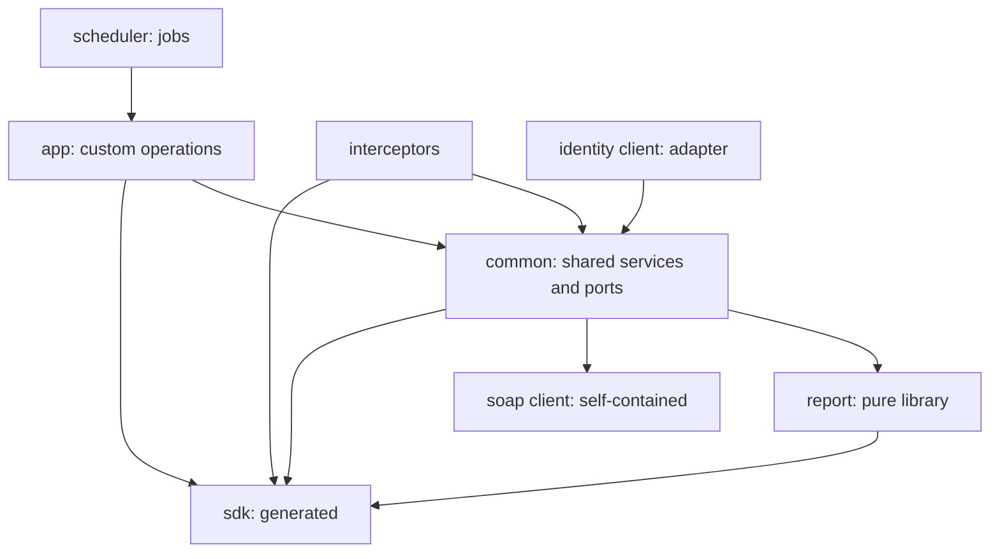

## Intent

Once an application adds its own modules next to the generated ones (see [[osgi-karaf-bundle-architecture]]), decide which module may depend on which. A fixed, one-way direction keeps `app` and `interceptors` as thin consumers, keeps heavy libraries out of them, and prevents Maven cycles and OSGi wiring surprises.

## Practice

### Platform base

- The generated modules form the bottom of the graph: `sdk` (interfaces and DAOs), `internal`, `rest`, and the model. They are generated and not edited; custom code lives in `app` and `interceptors` ([backend architecture](../../agent-docs/backend/README.md#architecture)).
- Custom operation implementations and interceptors are Declarative Services components ([OSGi component registration](../../agent-docs/backend/custom-operations.md#osgi-component-registration-pattern)). Everything else in this entry is a convention.

### Practice notes: four roles for hand-written modules

Give every extra module exactly one role and let dependencies point only downwards:

| Role | Example modules | Holds | Publishes components |
|---|---|---|---|
| Consumer | `app`, `interceptors` | operation implementations, interceptors | yes |
| Shared service | `common` | service interfaces and implementations used by more than one consumer, helper classes, i18n resources, ports for external systems | yes |
| Pure library | `report` | static utilities and stateless renderers | **no** |
| Client | SOAP client, identity-provider client | one external system each | yes, own interface or an adapter for a port in `common` |

Rules that keep the graph one-way:

- **Nothing depends on a consumer.** Shared logic that two consumers need moves to `common`, never into `app` with `interceptors` importing it ([[osgi-service-layer-delegation]]).
- **A pure library publishes no services.** No `@Component`, `@Reference` or `@Designate` in its `src/main`; the component that wraps it lives in `common`. A one-line grep guard in the module's own notes keeps this true.
- **Ports in `common`, adapters in the client.** When `common` needs an external system, declare the interface in `common` and implement it in the client module, so the client depends on `common` and not the other way round ([[external-api-adapter-pattern]]). A self-contained client with its own API (a WSDL-generated SOAP client) depends on nothing custom and exports only its API package ([[soap-client-integration]]).
- **A library that two bundles import pins the same version range in both manifests**, so both resolve to the same bundle in Karaf.
- Write the direction down in the module's notes ("`common` depends on this module; this module never depends on `common`").

## Rationale

- Consumers stay small and regenerate-safe; shared logic is testable without the operation context.
- A library module without components can be unit-tested with no OSGi runtime at all.
- One-way edges keep the Maven reactor order obvious and stop the stale-jar class of build failures ([multi-module build order](../../agent-docs/deployment/build-process.md#stale-artifacts-and-multi-module-build-order)).
- Cost: one more module per role; for a handful of operations this is overhead.

## Example

Observed graph in one application: `app` → `common`, `report`, a SOAP client, `sdk`; `interceptors` → `common`, `sdk`; `common` → `report`, the SOAP client, `sdk`; `report` → `sdk`; the identity-provider client → `common` (it implements the user-service port declared in `common`); the SOAP client → nothing custom.

One edge breaks the rule: the `scheduler` module depends on `app` to call operation-level services. It works because nothing depends on `scheduler`, but it couples job code to the operation bundle; moving the shared services into `common` would remove the edge.

## When to avoid

- A small application with only `app` and `interceptors`: keep shared helpers in a package of `app` until a second consumer needs them.
- Do not create a module per helper class; a role, not a class, justifies a module.

## Related

- [[osgi-karaf-bundle-architecture]] — which modules exist; this entry adds the allowed edges between them
- [[osgi-service-layer-delegation]] — how operations delegate to services in `common`
- [[external-api-adapter-pattern]] — port and adapter split for external systems
- [[soap-client-integration]] — self-contained client bundle
- [[structure-adding-a-custom-backend-module]] — wiring a new module into the build and the Karaf feature
- [[structure-third-party-wrapper-bundle]] — modules that only repackage a library
