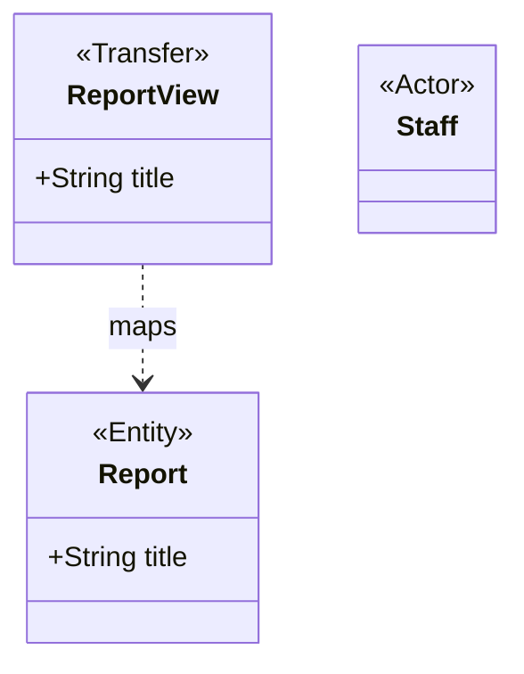

## Intent

An `Access` on an actor defines a data surface (target transfer object, cardinality, getter, create/update/delete flags). It does not put anything in the navigation. An actor with several accesses and no menu items shows an empty sidebar: the pages exist and can be reached by URL, but nobody finds them.

## Practice

Every access meant to be reached from the UI gets its own `MenuItemAccess`, either directly in the actor's `menuItems` or nested in a `MenuItemGroup`. Create the menu item in the same authoring step as the access. An access that is intentionally API-only is the one exception: say so in the model documentation.

- **Access** carries data semantics only. It has no icon, label or "show in menu" flag.
- **MenuItemAccess** carries the navigation chrome: `label`, `iconName`, `hidden`, `hiddenBy` and `enabledBy` (a data feature that drives visibility or enabled state) and a reference to one `Access` ([ui package reference](../../agent-docs/model/esm_metamodel/ui.md), *MenuItemAccess*). Hiding an entry is done on the menu item, never on the access, so a hidden entry still needs its `MenuItemAccess`.
- **MenuItemGroup** is a container with its own label, icon and `hidden`/`hiddenBy`; use it when there are many top-level entries or the sections are meaningful (*MenuItemGroup* in the same reference). The actor's `menuOrientation` (`VERTICAL` or `HORIZONTAL`) sets the drawer layout.
- **Order:** menu order is list order. Decide the top-to-bottom order before creating the items.
- **Table columns:** a list-cardinality access renders a table page, so its target transfer object also needs a table with at least one column, otherwise validation fails ([accesspoint reference](../../agent-docs/model/esm_metamodel/accesspoint.md), *UI Requirements on the Target TO*).
- **Audit:** the UI authoring guide checks the wiring by counting, per actor, accesses and menu items; an actor with accesses but zero menu items has only API-only accesses ([UI authoring guide](../../agent-docs/model/ui-authoring-guide.md), section 15, step 3).
- Project practice (the agent-docs do not describe it, treat as *verify* for your generator version): the generated drawer and routing files (`menu-items.tsx`, `routes.tsx`) were protected by `.generator-ignore` in these projects, so adding a menu item to the model did not change them and the entries had to be added by hand there. Custom routes belong in `extra-routes.tsx` ([extension points](../../agent-docs/frontend/extension-points.md), *Extra Routes*), which the docs say to protect in `.generator-ignore`; one project saw it overwritten when unprotected. A frontend `build -f` right after `transform --load` failed on the checksum file in one project (use the ignore-checksum build option; see [build and deployment](../../agent-docs/frontend/build-and-deployment.md), *Checksum Handling*).

## Rationale

- One rule, "create the access, create the menu item", removes the most common cause of a blank menu after deployment.
- Data (`Access`) and chrome (`MenuItemAccess`) stay separate.
- The cost is two model elements per entry and attention to ordering.

## Example

A staff actor has a `reports` access whose target is a report view with a table and one column. The actor also has a menu item bound to that access, with a label and an icon. Without the menu item, `reports` would exist but not appear.

Observed in projects:

- **judo-demo-miniworkflow:** the generic actor's accesses (documents, waiting for approval, users and others) each have a menu item with an icon. Admin-only entries are hidden by a `hiddenBy` flag on the menu item.
- **mlszksz-platform:** the admin actor has 13 accesses and 13 menu items, one-to-one, each with icon and label.
- **reserveapp:** the admin actor has 13 accesses and 13 menu items; actors that have no accesses yet (logistician, doorman, read-only) have no menu items.
- **ams-frontend:** manager and admin actors each have 3 accesses and 3 menu items with their own icons.
- **compsychletter (anti-example):** a user actor declared 3 derived accesses (documents, authoring, data) and 0 menu items. The generated menu was empty and only `/` was routed, so a signed-in user saw a blank sidebar. The pairing step was simply not done yet; a later phase was to add the three menu items.

## When to avoid

- Accesses that are intentionally API-only (programmatic or internal): skip the menu item and document why.
- Actors with `kind` SYSTEM: no UI is generated for them ([accesspoint reference](../../agent-docs/model/esm_metamodel/accesspoint.md), *ActorKind Behaviour*).

## Related

- [[panel-dashboard-transfer]] — the dashboard transfer object these accesses target
- [[self-access-point]] — self-getter accesses also need a menu item
- [[derived-access-filtering]] — derived accesses, with `hiddenBy` on their menu items

## Structure diagram

<!-- mermaid:generated fragment=access-paired-with-menu-item cli=1.1.0.20261108_202643_d9769d90_develop -->

<!-- /mermaid:generated -->
