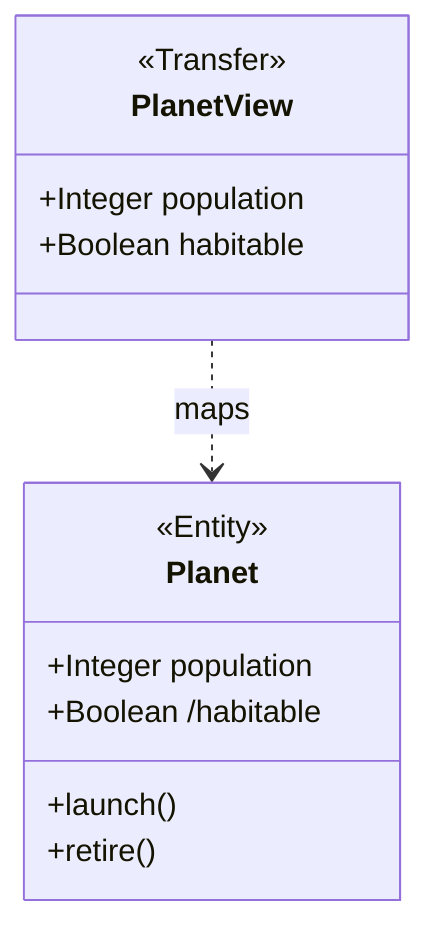

## Intent

Several operations of one object belong together and are valid only in some states. Put their buttons into one ActionGroup, show the most important ones as standalone buttons, and let one derived boolean decide whether the group is usable.

## Practice

### Bind the group to a boolean on the same transfer object

The UI model's ActionGroup holds a list of operation buttons (OperationForm elements, each bound to an operation by name). Its `enabledBy` (and `hiddenBy`) reference a boolean data member of the **same transfer object** that owns the page. No cross-object reference is possible, so a state computed elsewhere must first be exposed on that transfer object.

- Make the boolean a derived member of the entity (here `habitable`, computed from the entity's own state) and map it into the transfer object. It is true when the group should be usable.
- `enabledBy` disables the group when the boolean is false. `hiddenBy` removes it instead. Pick one: disabled keeps the controls visible for orientation, hidden removes noise.
- One boolean per group. Combine several conditions inside the derived expression, not in the UI model.

### Split featured and secondary actions

`featuredActions` is the number of leading actions shown as standalone buttons. The remaining actions of the group go into a pop-up menu button. Order the actions so the most common ones come first.

### Keep the operation itself safe

The boolean only controls the generated UI. An API client can still call the operation, so the operation body (or a before-interceptor) must reject a call that is invalid in the current state. See [[derived-attribute-flattening]] for the derived member and [[ui-control-transfer-fields]] for the same idea applied to other UI state.

## Rationale

- One derived boolean keeps the enabling rule in the model next to the data it reads, so every page that shows the group behaves the same.
- Standalone plus pop-up buttons give a visual hierarchy without custom components.
- The platform docs list the ActionGroup attributes (`label`, `iconName`, `col`, `actions`, `featuredActions`, `hiddenBy`, `enabledBy`). Page state handling (view or edit pages, device layouts) is produced by the UI generator; this practice does not define it. The agent-docs do not describe a separate disabled or read-only switch on the group, so do not rely on one.
- Limit: a single reference per group, no compound expression in the UI model.

## Example

A Planet entity has a derived boolean `habitable` and two operations (`launch`, `retire`). The PlanetView transfer object maps Planet and carries the boolean; the operations are declared on Planet. The view page holds one ActionGroup with `enabledBy` pointing at `habitable` and `featuredActions` of 1: `launch` is a standalone button, `retire` sits in the pop-up menu. When `habitable` is false, the whole group is disabled. The original project used four operations with two featured actions. Entity and transfer names here are neutral stand-ins.

## When to avoid

- Each operation has its own, different enabling condition: bind each button to its own guard instead of a shared group flag.
- A single operation: a plain button is enough.
- The condition depends on data that is not on the page's transfer object and cannot be derived into it.

## Related

- [[derived-attribute-flattening]] — provides the derived boolean that `enabledBy` references
- [[ui-control-transfer-fields]] — similar UI-state-from-model approach

## Structure diagram

<!-- mermaid:generated fragment=action-group-conditional-enabling cli=1.1.0.20261108_202643_d9769d90_develop -->

<!-- /mermaid:generated -->
