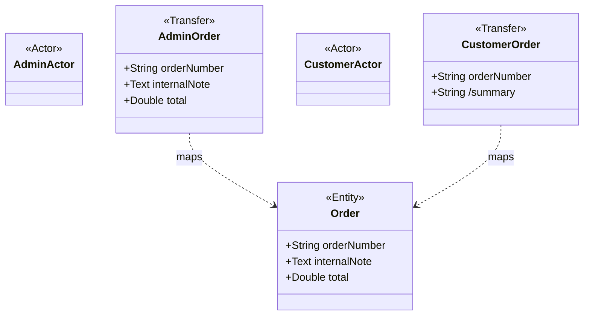

## Intent

Different actors (roles) need different views of the same entity. Give each actor its own transfer objects over the shared entity, with its own member selection, derived display fields and permissions, instead of one transfer object that serves everybody.

## Practice

### One entity, one transfer object per actor role

- Entities stay in one shared package. A transfer object is a mapped projection of an entity (it has a `mapping` to the entity) and selects which entity attributes and relations the actor can see.
- Each ActorType gets its Access entries pointing at that actor's own transfer objects. An Access carries the permissions (`createable`, `updateable`, `deleteable`) and an optional `getterExpression` that narrows the visible rows (see the platform's accesspoint reference). Entities and transfer objects are separate layers: the transfer object's own `createable`, `updateable` and `deleteable` flags say what the transfer type allows, the Access says what this actor may do through it.
- A full-access projection (admin) exposes many members and the CRUD flags. A restricted projection exposes few members, usually MAPPED read-only or DERIVED ones, with the flags off.
- A member that exists only for one actor (a display label, a flag for the UI) is a DERIVED member of that actor's transfer object, not a new entity attribute. A transfer-object member cannot reference another transfer object's members: `hiddenBy`, `enabledBy` and `requiredBy` must name a boolean on the same transfer object.

### Name and package by actor

Prefix or package the transfer objects by actor (for example an admin package and a customer package, or `AdminOrder`, `CustomerOrder`). Neutral per-actor names keep generated UI names and operation URLs unambiguous. Every mapped transfer object that takes part in the UI needs its View, Form and Table pages in the UI model; the generator-side rules are in the [UI authoring guide](../../agent-docs/model/ui-authoring-guide.md).

### Pair each Access with a menu entry

An Access grants data permission only. For a page to be reachable it needs a MenuItemAccess under the same actor's menu items, otherwise the target is API-only. See the accesspoint reference in the agent-docs for the pairing rule.

### Row scoping is separate from the projection

The projection decides which fields an actor sees; the Access `getterExpression` decides which rows. Do both: a restricted projection over an unfiltered Access still lists every row. See [[derived-access-filtering]].

## Rationale

- Each client receives exactly the data it needs and cannot read fields that were never exposed.
- Entity changes stay in one place; each projection adapts independently.
- Cost: more transfer objects and some repeated mappings across actors. Project practice (not platform behaviour): many projects accept the duplication, and keep one transfer object per actor and entity rather than inheritance between them. [[service-based-transfer-organization]] is the alternative organisation.

## Example

An Order entity has a number, a total and an internal note. AdminOrder maps all three and is createable, updateable and deleteable. CustomerOrder maps the number and adds a DERIVED summary, with the CRUD flags off, and leaves the internal note out. AdminActor has an Access to AdminOrder with all permissions. CustomerActor has a read Access to CustomerOrder. Names are neutral; the shape is the one drawn below.

## When to avoid

- One role only, or all roles see the same data: map one transfer object per entity.
- The difference between roles is only the row set: use one transfer object and different Access getter expressions.
- Needs that cut across entities (dashboards): use a panel transfer object with derived relations, see [[panel-dashboard-transfer]]. It must be mapped if an actor access targets it; an unmapped transfer object ([[unmapped-transfer-dto]]) fits operation inputs and outputs.

## Related

- [[derived-attribute-flattening]] — derived members used in restricted projections
- [[unmapped-transfer-dto]] — transfer objects without an entity mapping
- [[derived-access-filtering]] — row scoping on the Access
- [[service-based-transfer-organization]] — alternative: organise by service instead of by actor

## Structure diagram

<!-- mermaid:generated fragment=actor-based-transfer-projection cli=1.1.0.20261108_202643_d9769d90_develop -->

<!-- /mermaid:generated -->
