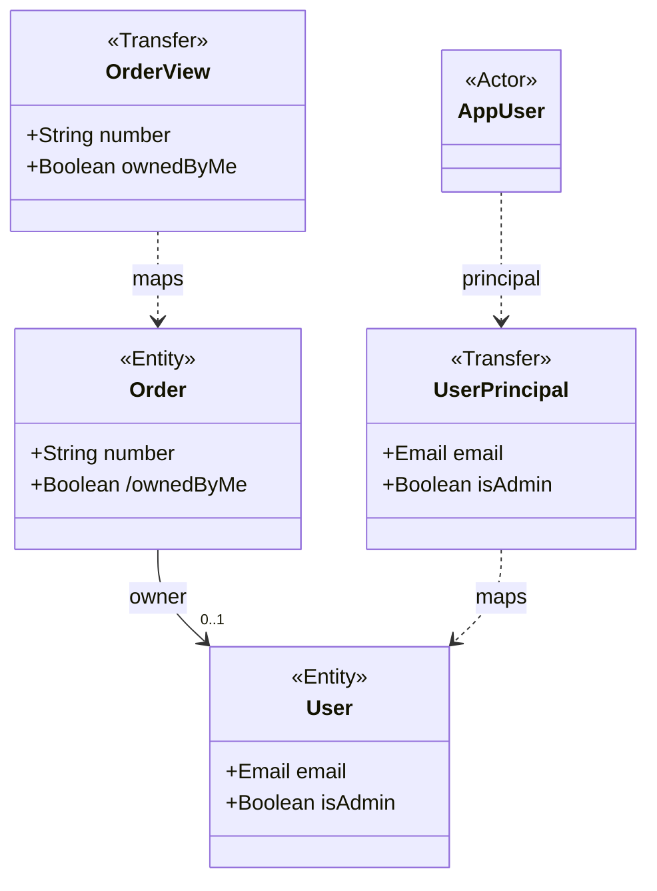

## Intent

Operations, derived members and Access getters often need to know who is calling: to find the current user's row, to keep users inside their own data, or to flag what the caller may do. Read it with the typed `!getVariable` call in JQL instead of passing the user in as a parameter.

## Practice

### Pick the variable category by actor shape

`!getVariable(category, name)` is typed by the primitive it is called on (for example `String!getVariable("ACTOR", "email")`) and always returns one scalar. The platform has three user-related categories (see the [model development guide](../../agent-docs/model/model-development.md) and the [ACTOR vs PRINCIPAL vs USER section](../../agent-docs/model/advanced-modeling-patterns.md#actor-vs-principal-vs-user-context-variables)):

- `ACTOR` reads an attribute of the persisted principal row. It is populated only when the actor's principal is a **mapped** transfer object over an entity (the managed mapped principal shape). The name is the member name on the principal transfer object, not the JWT claim name.
- `USER` reads the raw token claims and works for every actor shape. It is the only choice for a token-only actor (no principal transfer object).
- `PRINCIPAL` reads attributes of an **unmapped** principal transfer object. Against an actor without a principal it compiles but is empty at runtime.

A wrong category is a silent failure (empty values, no build error). Check every access getter and operation again when an actor gains or loses its principal.

### Typical uses

- **Find the current user row:** filter the user entity by the unique key that the claim maps to, for example by email, and take any. This is a scalar compared with a column, never a navigable actor. To navigate from the user, filter the entity again.
- **Scope an Access:** a derived Access whose getter filters the shared entity by the owner's key keeps a user inside their own rows. See [[derived-access-filtering]].
- **Derived permission flags:** a derived boolean on the entity, such as an owned-by-me flag, compares the owner with the actor value. Expose it on the transfer object and bind a button or action group to it. See [[action-group-conditional-enabling]].
- **Role flag:** store the role as a boolean on the principal entity, map it into the principal transfer object, and read it with a Boolean `ACTOR` lookup anywhere a boolean is expected.
- **Defaults:** a convention (not described in the agent-docs): `Email!getVariable("ACTOR", "email")` as the default of an audit attribute.

### What the actor needs

For `ACTOR` lookups the chain must be complete: a mapped principal transfer object, `managed` set, a claim of type EMAIL or USERNAME that points at a MAPPED member of the principal, and that member bound to an identifier or derived attribute of the entity (the validator reports otherwise). The platform docs note that in the documented runtime versions only the lookup is implemented; the first-login insert needs an authentication interceptor (see the [authentication guide](../../agent-docs/backend/authentication-guide.md)).

## Rationale

- No explicit user parameter: the caller cannot spoof another user.
- The lookup is evaluated per request, so a getter always reflects the signed-in user.
- One extra row lookup per evaluation when the user is re-queried; the persisted role flag form avoids it.
- Practice note: most projects key the lookup on email; one project used `USER` for the same purpose because its actors had no mapped principal.

## Example

An Order has an owner (a User with a unique email). The actor's principal is a mapped transfer object over User, with an EMAIL claim on the email member. The actor's orders Access is derived: it takes the Orders whose owner email equals the actor's email, so the caller sees only their own orders. Order also has a derived boolean saying whether the signed-in user owns it, which the order view uses to enable its buttons.

## When to avoid

- Token-only actors: use `USER`, not `ACTOR`.
- The value is a plain request input that the caller legitimately chooses: pass it as an operation parameter.
- The code runs outside an authenticated request (jobs, startup): there is no actor.

## Related

- [[derived-access-filtering]] — row scoping through the Access getter
- [[default-value-patterns]] — default expressions on attributes
- [[action-group-conditional-enabling]] — derived flags that drive button state

## Structure diagram

<!-- mermaid:generated fragment=actor-context-variable-lookup cli=1.1.0.20261108_202643_d9769d90_develop -->

<!-- /mermaid:generated -->
