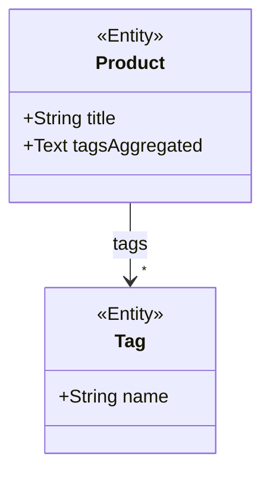

## Intent

A summary of a collection (for example a comma-separated list of tag names) is shown on every list row and used in search. Store that summary in a dedicated attribute of the owning entity and refresh it when the collection changes, instead of computing it on every read.

## Practice

### Store the summary next to the collection

- Add a STORED text or string attribute on the owner, named after the collection with an `Aggregated` suffix (project naming practice, not a platform rule). The collection stays a normal 0..* relation.
- The attribute is plain stored data: the platform does not recompute it. The model alone cannot keep it correct, so something in code has to write it.
- Because it is stored it can be filtered and sorted like any attribute, and it adds a column to the owner table.

### Refresh it from an operation interceptor

The platform's backend docs describe this denormalisation as an `OperationCallInterceptor` pattern (see the [interceptors guide](../../agent-docs/backend/interceptors.md), "Data Denormalization and Aggregation"): in the post-call hook of the owner's update, read the related rows, build the summary, and write it back only when it differs from the stored value. Collection changes made through other operations (adding or removing a related row through its own relation operation, imports, batch jobs) bypass that interceptor, so every writer of the collection needs the same refresh, or a single shared helper. Use the DAO for the write.

### Keep the stored value out of client writes

Make the field read-only on the transfer objects clients write through, so only the refresh code changes it.

## Rationale

- Reads are cheap: list pages and search use one column and no join.
- The cost is staleness risk and duplicated data. If a refresh is missed, the summary lies until the next refresh. Decide who owns the refresh before adding the field.
- If the value must always be exact and the collection is small, a DERIVED attribute computed with a collection function is simpler and cannot go stale. See [[derived-attribute-flattening]].
- Practice note (not platform): the original project used rich text for the summaries and updated them in custom backend code.

## Example

A Product has a title, a 0..* relation to Tag and a stored text attribute that holds the tag names joined with commas. The product update interceptor rebuilds the text after each update and saves it only when it changed. The shape is drawn below.

## When to avoid

- The summary is cheap to compute and must be always current: use a derived attribute.
- Many writers change the collection and you cannot route them all through one refresh.
- The collection is large and changes often: the refresh cost grows with every change.

## Related

- [[derived-attribute-flattening]] — alternative: compute on every read
- [[custom-implementation-placeholder]] — the refresh logic lives in custom code

## Structure diagram

