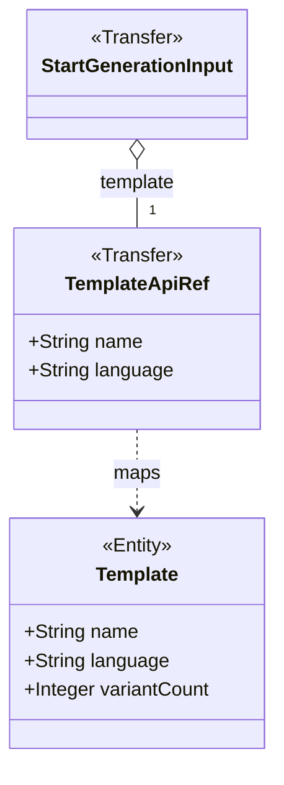

## Intent

An input transfer object in a stable API package needs a typed picker relation to an entity that the UI already projects in a dashboard package. Two shapes work: reuse the dashboard transfer object as the relation target, or declare a thin reference projection in the API package. This entry covers the thin variant and when it is worth the extra transfer object.

Dashboard projections grow derived attributes, lifecycle flags and embedded grids as the UI evolves. The API contract should not move with them.

## Practice

For each entity reachable from a stable API input, declare in the API package a reference transfer object (project naming: `<Entity>ApiRef`):

- It maps the entity (a mapped transfer object; see the mapped transfer object rules in [architectural patterns](../../agent-docs/backend/architectural-patterns.md) and the [structure reference](../../agent-docs/model/esm_metamodel/structure.md)).
- It is not createable, updateable or deleteable.
- It projects one to three mapped members: the identifying and display attributes (usually a name, sometimes one stable classifier such as a language or state). No mutable lifecycle attributes, derived counts or embedded relations; those stay on the dashboard transfer object.

The API input transfer object, which is unmapped, then holds a TRANSIENT relation to the reference transfer object. Rules that apply:

- A relation target is always a transfer object, never an entity; the link to the entity lives only in the reference's mapping.
- An unmapped transfer object may only have `AGGREGATION` relations, enforced by the validator ([advanced modeling patterns](../../agent-docs/model/advanced-modeling-patterns.md), *Relation kinds per layer and the bidirectional rules*). The CLI cannot set `AGGREGATION`; it is the default on an unmapped transfer object's transient relation, or the modeling tool sets it.
- The transient relation mechanism, its range and default expressions: see [[transient-relation-single-select-input]] and [[transient-relation-parameter]].

Choose between the two shapes:

| Concern | Thin reference | Reuse dashboard transfer object |
|---|---|---|
| Model surface | one more transfer object per target entity (mapping plus 1–3 members) | none |
| API stability | dashboard changes do not move the API contract | every dashboard attribute added shows in API responses |
| Picker | picker range runs against the reference; same backing entity | same (the picker needs only a mapped transfer object) |
| Test data | one more builder per reference | none |

The picker and body-access rows come from the old project notes; the agent-docs do not describe them, so treat them as *verify*.

## Rationale

- Cross-package coupling is avoided: the API package does not depend on the dashboard package.
- Reuse is fine when API and UI are co-versioned (MVP, internal-only APIs, prototypes). Switch to thin references when an external HTTP client exists or the dashboard transfer object has grown beyond what a picker needs (project note: 20+ attributes and three embedded grids is too much for a reference).
- Review check: a healthy reference has a mapping, at most three attributes and no relations. A reference with embedded relations or more attributes has drifted into a second dashboard transfer object.

## Example

Observed in compsych-letter-demo: the document-generation API inputs (start and confirm generation) needed pickers for template, data object, design and generation handle. Three of these had only dashboard projections with derived attributes (variant count, tokens, an embedded variants grid) that API consumers do not need; the data-object projection was already thin. The change added three reference transfer objects in the API package (template: name and original language; design: name; generation handle: handle id, document id and state) and four transient one-to-one relations on the input transfer objects pointing at the four references.

In the diagram, a template entity is mapped by a reference transfer object with two members, and an unmapped input holds a transient relation to it.

## When to avoid

- The dashboard transfer object is already minimal: a second mapping of the same entity adds a transfer object for no benefit.
- The reference would need derived attributes or relations: then it is not thin; reconsider the split.
- The relation target is the entity itself: not allowed on transfer objects.

## Related

- [[transient-relation-single-select-input]] — the relation mechanism these targets serve
- [[identifier-attribute-vs-relation]] — the decision rule that creates the need for a reference
- [[actor-based-transfer-projection]] — actor-scoped projections, the companion to API-scoped ones

## Structure diagram

<!-- mermaid:generated fragment=api-package-thin-ref-projection cli=1.1.0.20261108_202643_d9769d90_develop -->

<!-- /mermaid:generated -->
