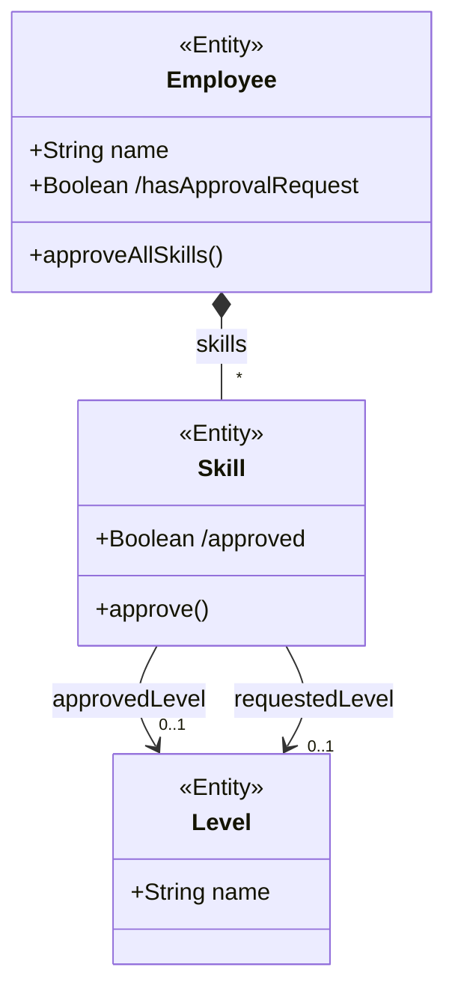

## Intent

A value must be proposed by one party and confirmed by another before it counts. Keep the proposed and the approved value side by side on the same entity, derive the approval status from the two, and make approval an operation that copies one to the other.

## Practice

### Two parallel members, one derived status

- The entity has two optional relations (0..1) to the same target, here `requestedLevel` and `approvedLevel`. The requester edits the first; only the approve operation writes the second.
- A derived boolean `approved` is true when both are set and equal. Because it is DERIVED it is always in step with the data and needs no storage.
- A parent can expose a derived boolean such as "has an open request": the parent's skills filtered by "not approved", counted, compared with zero. Use the count form; the platform docs list the collection functions, so check the JQL reference for the exact spelling before using other forms.

### Approve is an instance operation

`approve` is an instance operation with a JCL body that assigns the requested value to the approved relation. In a JCL script an instance refers to itself as `this` (the JQL word `self` is not a symbol there). See the [operation script reference](../../agent-docs/model/jcl-operation-scripts.md) for the statement set (`for (x in collection)`, assignments, calls).

### Bulk approval cascades through the hierarchy

A parent operation iterates the collection and calls `approve` on each element (`for (s in this.skills) { s.approve() }`). A further level can iterate the children and call the level below. Operation calls in scripts bind only the first argument, so keep these operations parameterless.

### Guard the operation, not only the button

The derived `approved` flag lets the UI enable or hide the button (see [[action-group-conditional-enabling]]). It does not stop an API call. Practice note, not platform behaviour: the approve operation checks that the caller may approve and that a requested value exists. If the check needs Java, make the operation custom and check in code (see [[mapped-operation-delegation]]).

## Rationale

- The requested and the approved value are both kept, so the history of what was asked versus what was granted is visible.
- Approval is one small operation; bulk approval reuses it.
- Cost: two relations for one logical value, and care when either is empty (the derived expression tests both with `isDefined`).
- It records only the current pair. A full history needs a separate entity (see the audit and snapshot entries in the catalog).

## Example

A Skill belongs to an Employee, has `requestedLevel` and `approvedLevel` relations to a Level entity, a derived `approved` flag and an `approve` operation. Employee has a composition of skills, a derived "has approval request" flag and an `approveAllSkills` operation that loops over the skills. Names are neutral; the original project also cascaded approval from a manager to subordinates.

## When to avoid

- Approval has several steps, comments or rejection reasons: use a state machine ([[enum-state-machine]]).
- Several people approve in turn or the approval must be logged: model an approval entity per decision.
- The value needs no confirmation.

## Related

- [[mapped-operation-delegation]] — delegating the operation to custom code
- [[derived-attribute-flattening]] — derived booleans and collection counts
- [[enum-state-machine]] — status-driven alternative for multi-step approval

## Structure diagram

