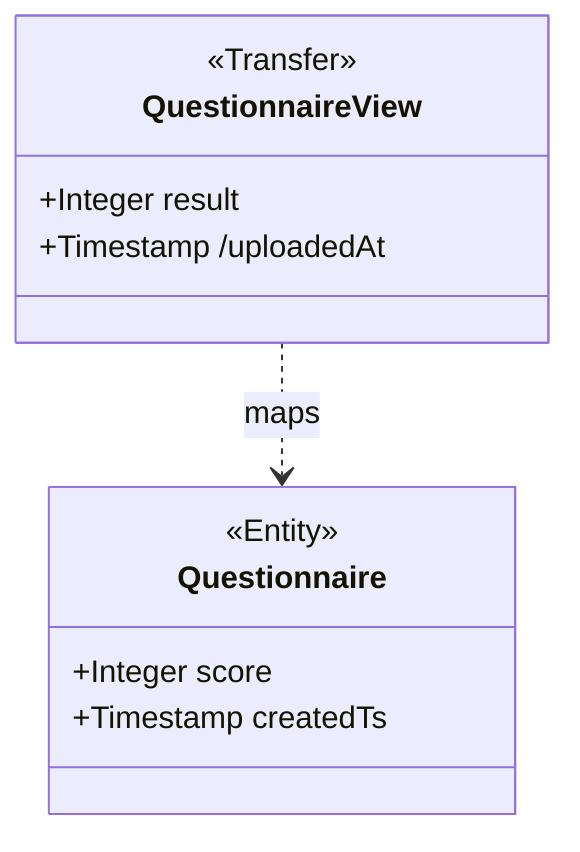

## Intent

The names that fit storage are not always the names that fit a client. A transfer object can present an entity attribute under a different, context-appropriate name without touching the entity.

## Practice

### Rename with a mapped member

A MAPPED member of a mapped transfer object has its own name and a `binding` to the entity attribute. The member `result` can bind to `Questionnaire.score`. Client code sees `result`; storage keeps `score`. A MAPPED member is allowed only on a transfer object that has a mapping to an entity, and it projects the bound feature (see the structure reference in the agent-docs).

- The binding makes the member editable or read-only according to the transfer object's rules. The member's type follows the bound attribute.
- Keep the rename consistent: if two transfer objects of the same entity expose the attribute, use the same new name in both, or the generated client types diverge.

### Rename a derived value with a getter

When the transfer must present a value that is read-only and under a new name, a DERIVED member whose getter expression reads the entity attribute (for example `uploadedAt` computed from the stored creation timestamp) does the same job. It cannot be written back. Choose MAPPED when clients must edit the value, DERIVED when they only read it.

### Make the rename visible

The mapping is the only place that says `result` is the entity's `score`. Name the transfer members for the client's vocabulary and record the mapping in the entity documentation, otherwise debugging a query or a filter on the stored column is harder. Generated UI labels come from the transfer member names (see [[naming-conventions]]).

## Rationale

- API and UI names can differ from storage names and stay stable when the stored name changes.
- Each actor can use its own vocabulary: see [[actor-based-transfer-projection]].
- Cost: one more indirection to remember. Practice note, not platform: the original project renamed only a few members, where the entity name was technical.

## Example

A Questionnaire entity has a stored integer `score` and a stored timestamp `createdTs`. QuestionnaireView maps Questionnaire, exposes `result` as a MAPPED member bound to `score`, and `uploadedAt` as a DERIVED member computed from `createdTs`. Names are neutral stand-ins.

## When to avoid

- The entity name is already the right name: map it unchanged.
- Several transfers rename the same attribute differently: agree one client vocabulary first.
- The value must be written back under the new name and a derived member would be read-only: use MAPPED.

## Related

- [[derived-attribute-flattening]] — derived members in transfer objects
- [[actor-based-transfer-projection]] — per-actor vocabularies
- [[naming-conventions]] — naming rules for model elements

## Structure diagram

<!-- mermaid:generated fragment=attribute-renaming-in-transfer cli=1.1.0.20261108_202643_d9769d90_develop -->

<!-- /mermaid:generated -->
