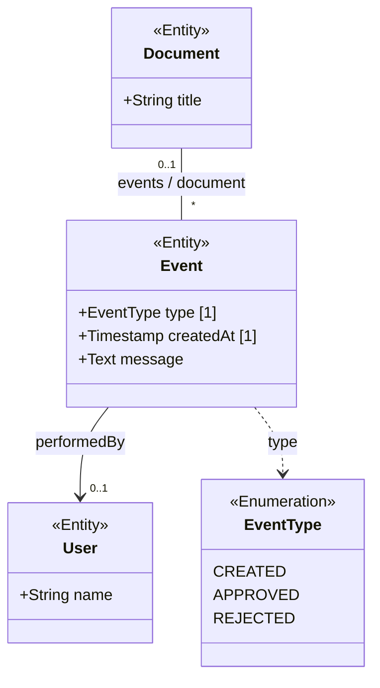

## Intent

Keep a chronological record of what happened to an entity: what (a category enumeration), who (a relation to the acting user), when (a timestamp) and to which entity (a relation to the subject). Events are only ever added.

## Practice

### An event entity that clients cannot write

- The Event entity has a required category enumeration (`type`), a required timestamp (`createdAt`), an optional text `message`, an optional `performedBy` relation to the user (optional so that system-initiated events fit) and a relation to the subject entity.
- Set `createable`, `updateable` and `deleteable` to false on the entity so the generated UI and API offer no create, update or delete. This only removes the generated actions; backend code that uses the DAO can still write rows.
- The subject holds the reverse collection of events (a two-way relation, 0..* on the subject side) so its page can show the history. A one-way relation from the event is enough when the subject page does not need the list.
- Ordinal values of the category enumeration stay fixed once data exists.

### Write the event in the same transaction as the action

The event is created by backend code, not by the user. Where the platform lets you hook in:

- Interceptors fire only for the built-in operations (create, update, delete, refresh, reference operations). They run inside the operation's transaction, so an interceptor exception rolls the business write back. Custom, mapped and script operations never hit interceptors (see the [interceptors guide](../../agent-docs/backend/interceptors.md), "Which Operations Are Intercepted").
- For a custom operation (for example finalize or approve) the operation itself must create the event, last, after the business action. Use the DAO of the Event entity. Wrap the call in a helper so every operation writes events the same way; such a helper is project code, not platform API.
- See [[audit-event-trail]] for the backend side of this practice.

### Do not use the event as the source of truth by accident

Project practice: one project derived the current state from the latest history entry (head of the entries ordered by time descending) instead of storing it. That works, but every state read then touches the history table; usually keep a stored status as in [[enum-state-machine]] and use the events as the trail.

## Rationale

- Immutable rows give a complete trail for debugging and compliance, and are cheap to query by subject, user or time.
- The cost is a growing table and a writer for every action; nothing in the model forces events to be written, so a forgotten call leaves a gap.
- A generalization hierarchy per event kind (one subtype per event) is an alternative to the enumeration. It allows kind-specific fields but multiplies entities.

## Example

An Event entity has a required EventType (created, approved, rejected), a required timestamp, an optional message and an optional performedBy relation to a User. A Document has a collection of events. The Event entity is not createable, updateable or deleteable. The document's approve operation creates an APPROVED event as its last step. Names are neutral stand-ins for the originals.

## When to avoid

- One entity's field history is wanted: see [[entity-change-history-snapshot]].
- Only the current status matters and no trail is required.
- Events must survive deletion of the subject: use an association and keep the foreign key nullable, or copy the subject key into the event.

## Related

- [[enum-state-machine]] — events track the state transitions
- [[category-enum-pattern]] — the event type classifies events
- [[custom-implementation-placeholder]] — events are created in custom code
- [[audit-event-trail]] — backend practice for writing the events

## Structure diagram

<!-- mermaid:generated fragment=audit-event-entity cli=1.1.0.20261108_202643_d9769d90_develop -->

<!-- /mermaid:generated -->
