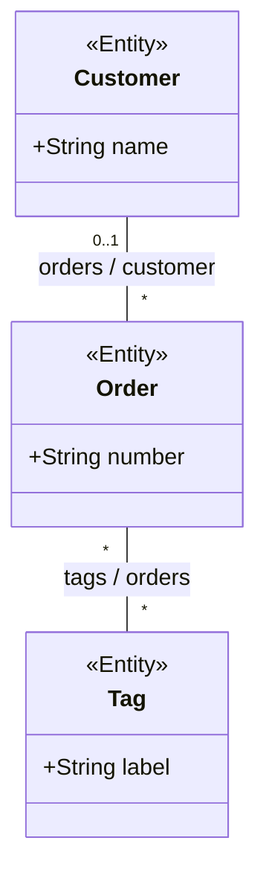

## Intent

Two entities need to navigate to each other and the platform should keep both ends consistent. Declare the relation as a two-way relation: two members that name each other as `partner`.

## Practice

### Declare both ends and point them at each other

- A TwoWayRelationMember exists only on entities, never on transfer objects. Each end names the other as its `partner`. The two ends may have different cardinalities: a Customer has `0..*` orders, an Order has `0..1` customer.
- Setting the relation from either side changes the other, because it is one stored relation seen from two ends. There is no second column to keep in step.
- Many-to-many is allowed (`0..*` on both ends). Exactly one end of each pair is `primary`, which resolves ownership of the stored relation; project practice is to make the "many"/owning side primary.

### Relation kinds and the validator

The platform's validator enforces these rules (see [Asymmetric bidirectional relations](../../agent-docs/model/advanced-modeling-patterns.md#pattern-asymmetric-bidirectional-relations-aggregation--association) in the agent-docs):

- A two-way relation cannot be a COMPOSITION on either end.
- The partner of an AGGREGATION end must be an ASSOCIATION. If you use AGGREGATION, put it on the collection (owner) end and ASSOCIATION on the back-pointer. ASSOCIATION on both ends is also valid.
- At least one end must have a lower bound of zero. Relax the owner collection end, not the child end, so referential integrity of the child stays intact.
- ASSOCIATION is not forbidden on entities; which kind to use is a design choice.

### Hierarchies and ownership

For a real parent-child ownership with cascade delete, use a one-way COMPOSITION with a container back-reference instead; see [[composition-ownership]] and [[container-back-reference]]. A self-referencing two-way pair (manager and subordinates) works the same way.

### Use it in expressions and UI

Both ends are normal members, so JQL navigates in both directions and derived members can use either end. Whether the transfer objects expose the back end is a separate choice: the model can keep the back end internal. Mind the CRUD flags (`createable`, `updateable`, `deleteable`) on each end: they control which relation actions the generated UI offers, so a many-to-many pair often switches them off on one side.

## Rationale

- One relation, two entry points: no manual bookkeeping and no drift.
- Cost: both entities depend on each other, and each end adds a member to generated code and pages.
- Prefer a one-way relation when only one side ever navigates; it keeps the other entity free of the dependency.

## Example

Customer has an `orders` collection (`0..*`) and Order has a `customer` (`0..1`): one pair, with the Customer end primary. Order and Tag form a many-to-many pair, with `tags` on Order and `orders` on Tag; Order is primary. Names are neutral stand-ins for the original domains.

## When to avoid

- One direction is enough: use a one-way relation.
- The child is owned and deleted with the parent: use a composition and a container back-reference.
- You need data on the link itself (date, role): model a junction entity with two one-to-many pairs instead of a many-to-many pair.

## Related

- [[composition-ownership]] — owned children with cascade delete
- [[container-back-reference]] — back navigation for compositions

## Structure diagram

<!-- mermaid:generated fragment=bidirectional-relation cli=1.1.0.20261108_202643_d9769d90_develop -->

<!-- /mermaid:generated -->
