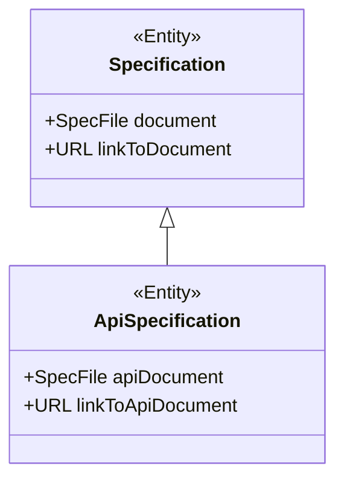

## Intent

A document should be available either as an uploaded file or as a link to where it is hosted. Keep a binary attribute and a companion URL attribute side by side on the entity. Both are optional, and the user supplies whichever exists.

## Practice

### Pair a binary attribute with a URL attribute

- The binary attribute uses a BinaryType. The platform requires at least one allowed MIME type on the binary type (`type/subType`, for example a PDF), and an optional maximum size in bytes (default 50 MB). Declare the types once per model and reuse them. See the [type reference](../../agent-docs/model/esm_metamodel/type.md).
- The link is a plain string, usually the model's URL type. It holds an address only; the platform does not fetch or check it.
- Both attributes are optional on the entity. If at least one must be present, express that as a rule in an operation or a validating interceptor, since the model has no "one of" constraint. Project practice: the original project left both optional and relied on users.
- Decide whether the two may disagree. If the upload and the link must describe the same document, say so in the UI labels; the platform does not compare them.

### Repeat the pair in subtypes

A base entity carries the generic pair (`document`, `linkToDocument`). Subtypes add their own pairs for specific formats (for example an API description document and its link). Subtypes inherit the base attributes through generalization; see [[generalization-base-entity]].

### How the file moves

Binary values do not travel as bytes inside the record. A transfer field that maps a binary on a create-capable transfer gets a generated upload-token operation. The client requests a token, uploads the content to the file store with it, then sends the token as the attribute value in create or update. An invalid token fails with `INVALID_FILE_TOKEN` (see the [platform behavior reference](../../agent-docs/backend/platform-behavior-reference.md)). The URL attribute is an ordinary string and needs none of this.

## Rationale

- Users can upload a file when they have it and paste a link when it is hosted elsewhere, with no new entity.
- Cost: two fields for one concept, a possible mismatch between them, and file storage for the uploaded part.
- A separate document entity (see [[document-file-attachment]]) is better when one parent has many documents.

## Example

A Specification entity has an optional `document` (a binary type allowing PDF, with a size limit) and an optional `linkToDocument` (URL). An ApiSpecification subtype adds `apiDocument` and `linkToApiDocument`. Names are neutral; the original project used this for interface specifications such as REST and SOAP descriptions.

## When to avoid

- The document is always uploaded or always external: keep one attribute.
- One parent has several documents: model a Document entity with its own binary and a relation to the parent.
- Files need versions or review: model it as an entity with history.

## Related

- [[standard-type-library]] — the binary and URL types
- [[generalization-base-entity]] — base entity carrying the generic pair
- [[document-file-attachment]] — a separate document entity for several files per parent

## Structure diagram

<!-- mermaid:generated fragment=binary-document-with-link-pattern cli=1.1.0.20261108_202643_d9769d90_develop -->

<!-- /mermaid:generated -->
