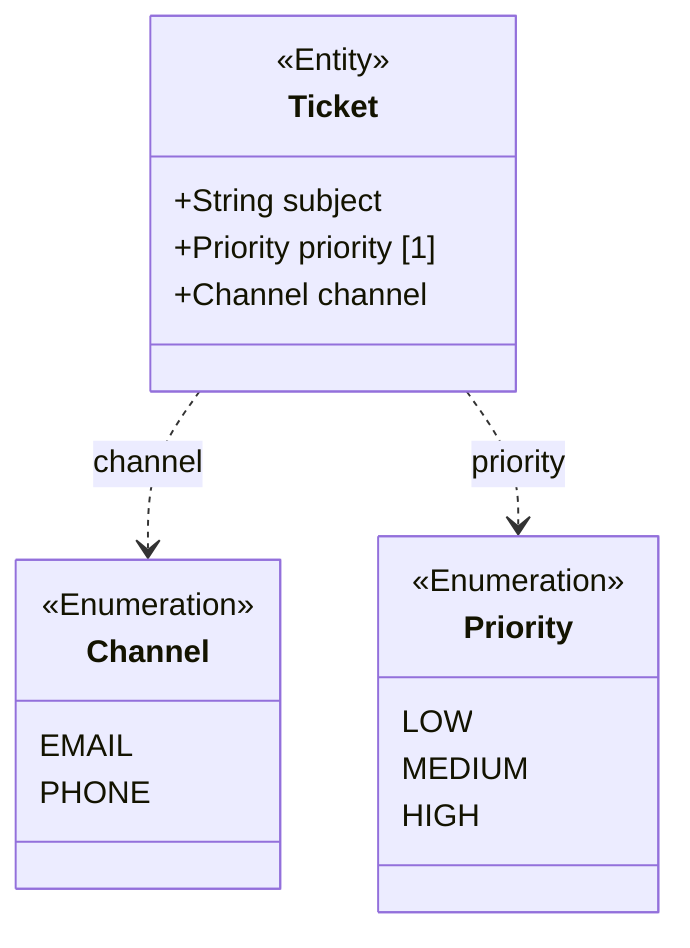

## Intent

Some entities need a classification from a small fixed vocabulary that is set at creation and does not move through a lifecycle: priority, channel, platform, type. Model each classification as an enumeration and use it as an attribute.

## Practice

### One enumeration per classification dimension

- Define a separate EnumerationType for each dimension (priority, channel). An entity can carry several, which gives orthogonal classifications.
- Each member has a name and an integer ordinal. The ordinal must be unique within the enumeration and, in JSL models, between 0 and 9999 (see the [type reference](../../agent-docs/model/esm_metamodel/type.md)). Values are persisted by ordinal, so never renumber or reuse an ordinal once data exists; append new members with new ordinals. Starting at 0 or 1 is a project choice.
- Use the enumeration as the type of a STORED attribute. Make it required when every row must be classified, and give it a default through the attribute's default expression, written as the enumeration name, `#` and the member (the JQL literal form, for example `Priority#MEDIUM`).

### Use the classification in the model and in code

- Filter and group by it in access getters and derived members with the same literal form.
- Practice note: category enumerations that drive branching in operations (for example which credential type is valid) are fine, but if the value changes through transitions it is a state, not a category: use [[enum-state-machine]].
- Known generated-DAO issue (agent-docs backend data-access guide): the generated `query<Attribute>()` on an enumeration attribute can fail with a cast error because the runtime delivers the ordinal; read the value through the DTO or convert with `<Enum>.getByOrdinal(...)`.

### When the set must grow at runtime

An enumeration is fixed at build time. Adding a member needs a model change and a deployment. If administrators must manage the values, use a reference entity instead of an enumeration; see [[entity-as-enum-pattern]].

## Rationale

- A fixed vocabulary prevents inconsistent free text and gives the UI a ready list of choices.
- Filtering and reporting on an enumeration is simple.
- Cost: changes are model changes; ordinals are a permanent contract with stored data.

## Example

A Ticket entity has a required Priority (low, medium, high; default medium) and an optional Channel (email, phone). The two are independent dimensions. Neutral names stand in for the original classifiers.

## When to avoid

- The value changes through allowed transitions: use [[enum-state-machine]].
- The vocabulary changes often or per customer: use a reference entity.
- Only two values that mean on or off: a boolean may be clearer.

## Related

- [[enum-state-machine]] — enumerations that carry lifecycle transitions
- [[default-value-patterns]] — default expressions on attributes
- [[entity-as-enum-pattern]] — runtime-managed alternative

## Structure diagram

<!-- mermaid:generated fragment=category-enum-pattern cli=1.1.0.20261108_202643_d9769d90_develop -->

<!-- /mermaid:generated -->
