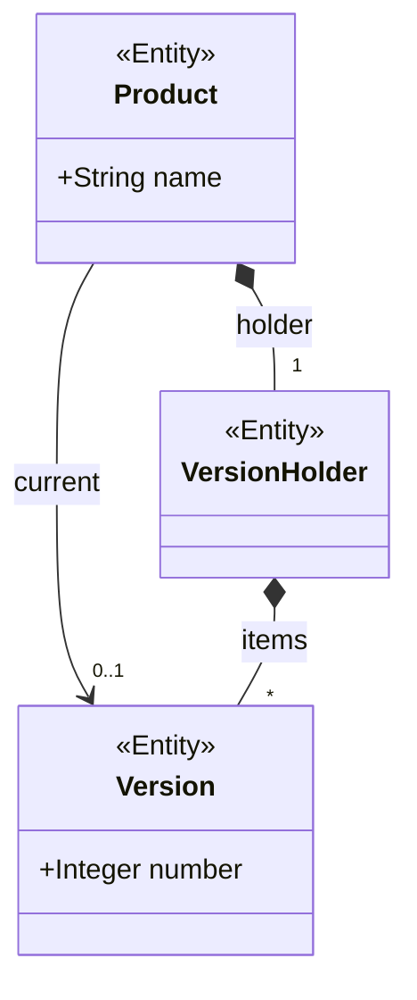

## Intent

A parent needs a stable object that stands for its collection: something to hang derived navigation on, such as "the latest version". Introduce a holder entity with no data of its own that holds the collection; the parent has a required single relation to it.

## Practice

### Shape

- The holder entity has no stored attributes. It has one 0..* relation to the item entity (the collection) and may have derived relations that aggregate over it.
- The parent has a required single relation (`1..1`) to the holder, so the holder always exists for a saved parent. Whether the parent-to-holder relation is a composition or an association is a design choice: a composition gives the holder the parent's lifecycle (deleted with it), and the original project used a plain stored association. Decide who owns the holder before choosing.
- The collection items are composed in the holder in the diagram below, which means they are deleted with it. Use an association instead when the items are shared or outlive the holder.

### Derive from the holder

A derived relation on the parent can navigate through the holder and pick one item: sort the items descending by a version number and take the head (`!sort` with a selector, then `!head()`). The platform docs say order is deterministic only after `!sort`, so always sort before `!head` or `!tail` (see the collection functions in the [model development guide](../../agent-docs/model/model-development.md)). A derived relation yields a single instance when its cardinality is `0..1`.

### Keep creation consistent

Because the parent requires the holder, whoever creates a parent must also create its holder. The model cannot do that on its own: do it in the create operation, an interceptor on create, or by providing the holder in the input. Without this, creating a parent fails on the required relation. See [[collection-lower-bound-zero]] for the cardinality rule of the collection itself.

## Rationale

- A stable anchor for derived navigation and for a single required reference to "the collection".
- The collection's lifecycle is separate from the parent's other data.
- Cost: an extra entity with no data, one more join, and creation code. A direct `0..*` relation on the parent with the same derived expression is simpler and works in most cases; use the holder only when something needs to point at the collection as one object.

## Example

A Product has a required `holder` to a VersionHolder. VersionHolder has an `items` collection of Version entities. The Product's derived `current` relation sorts the holder's items by version number descending and takes the head, so it is the latest version. Names are neutral; the original project used it for product versions.

## When to avoid

- A direct collection on the parent does the same job: use that.
- The collection never needs to be addressed as one object.
- You cannot guarantee that the holder is created together with the parent.

## Related

- [[derived-relation-navigation]] — navigation expressions that go through the holder
- [[collection-lower-bound-zero]] — cardinality of the collection
- [[composition-ownership]] — lifecycle of the holder and the items

## Structure diagram

