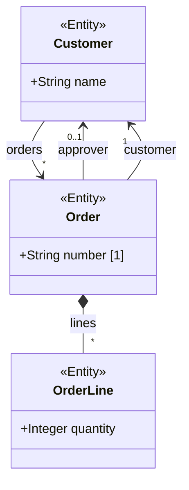

## Intent

Declare every collection relation with lower bound `0` (cardinality `0..*`) and keep "at least one" rules out of the model structure. The metamodel itself allows `1..*`; avoiding it is a convention.

## Practice

- Multi-valued relations use lower `0`, upper `-1`: `0..*`.
- A single-valued relation that must always point somewhere is `1..1`; an optional one is `0..1`.
- An actor access of type `ALL` is fixed to `0..*` by the platform, so unfiltered lists follow the same rule for free (see [accesspoint](../../agent-docs/model/esm_metamodel/accesspoint.md)).
- A rule such as "an order needs at least one line" is checked in an operation (or a project-level validation), not by the cardinality.

## Rationale

The cardinality table in [type.md](../../agent-docs/model/esm_metamodel/type.md) lists `0..1`, `1..1`, `0..*` and `1..*`, and the generated UI treats `lower = 1` as a required relation with a required indicator ([ESM to UI mappings](../../agent-docs/frontend/esm-to-ui-mappings/README.md)). A required collection therefore forces the parent to be created together with at least one child, which breaks the usual create-then-add flow of a form and of generated create operations. Keeping `0` lets the parent exist first and the children be added afterwards (for example in a composition, see [[composition-ownership]]). The cost is that the model cannot state "non-empty"; the check moves into code.

This is a convention layered on the platform: the platform accepts `1..*`, the catalog's projects consistently do not use it.

## Example

An `Order` owns its `lines` as a composition with cardinality `0..*`. Its `customer` is a required single relation (`1..1`) and its `approver` an optional one (`0..1`). The inverse `Customer.orders` is again `0..*`. No relation uses `1..*`.

Seen in 18 projects, none of which declares a collection with a lower bound above zero.

## When to avoid

- When the platform's required-relation behaviour is actually wanted: a hard `1..*` makes the generated forms demand at least one element, which is right only if the creating UI always supplies it.
- Operation parameters have their own `lower`/`upper`; this practice is about relations on entities and transfer objects.

## Related

- [[composition-ownership]] — composed children are created after their parent, hence `0..*`
- [[derived-state-from-history]] — a history collection starts empty

## Structure diagram

