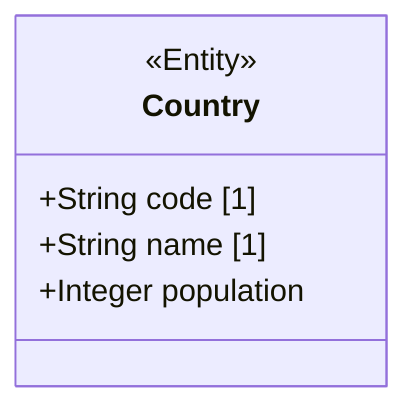

## Intent

Mark more than one stored attribute of an entity as `identifier`, typically a system code plus a human-readable name, so that either can serve as a lookup key.

## Practice

- `identifier` is a flag on a `DataMember`. It is available only when the container is an entity type and the member is `STORED` ([structure.md](../../agent-docs/model/esm_metamodel/structure.md), *DataMember Attribute Rules*). The docs call it the natural key field.
- Put the flag on two or more required String attributes, for example `code` and `name`.
- The `code` is usually produced by a default expression (see [[sequence-based-identifier]] and [[default-value-patterns]]); the name is entered by the user.
- Transfer objects that need to show or look up the entity expose both attributes as mapped members.

## Rationale

Entities often have a stable machine code and a label people recognise. Flagging both as identifiers documents both as natural keys in the model.

The agent-docs only say that `identifier` marks a natural key; they do not state how the flag on several attributes is enforced at runtime. Treat uniqueness of the combination and of each part as something to verify in the generated schema or to enforce in project code, and say so in the model's documentation.

## Example

A `Country` entity has two required String attributes flagged as identifiers, `code` and `name`, plus an ordinary `population` attribute. Seen in two projects, where up to four representations of one record (code, name, two ISO alphas) are flagged.

## When to avoid

- When one attribute is enough: a single identifier is simpler to reference and to use in expressions.
- When the second key is only a label that may change; a mutable name as a key makes renames awkward.
- When uniqueness must be guaranteed and you have not confirmed that the platform enforces it for your attributes.

## Related

- [[sequence-based-identifier]] — generating the code part
- [[naming-conventions]] — naming the key attributes

## Structure diagram

<!-- mermaid:generated fragment=composite-identifier-pattern cli=1.1.0.20261108_202643_d9769d90_develop -->

<!-- /mermaid:generated -->
