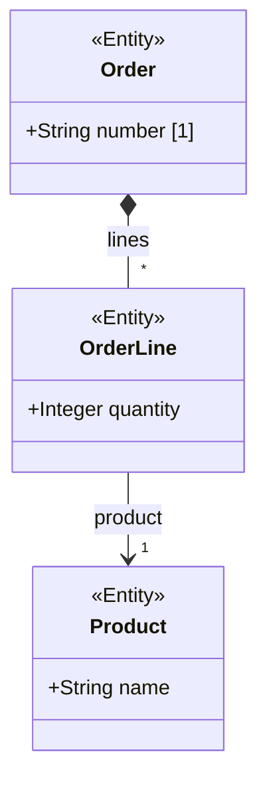

## Intent

Use `COMPOSITION` only for children whose lifecycle is bound to their parent; every other relation is an association or aggregation.

## Practice

- `COMPOSITION`: the parent owns the child, deleting the parent deletes its children ([structure.md](../../agent-docs/model/esm_metamodel/structure.md), *RelationKind Behaviour*).
- `AGGREGATION`: a reference only, no cascade. `ASSOCIATION`: a simple link without ownership.
- Typical ratio in the catalog's projects: a few compositions among many associations.
- A composed child can reach its owner with `self!container(ParentType)` in derived expressions (see [model-development](../../agent-docs/model/model-development.md), *Reference Functions*), see [[container-back-reference]].
- Composed collections are `0..*` ([[collection-lower-bound-zero]]).
- On the UI side a composition relation gives create and delete actions without a "remove" (the child cannot be detached), and a compact table is valid for it ([UI authoring guide](../../agent-docs/model/ui-authoring-guide.md)); other relation kinds get different action sets (same guide, relation-shape table).

## Rationale

Cascade delete removes dependent rows with their parent, so no orphans remain and no cleanup code is needed. Over-using composition couples entities: a composed child cannot be shared between parents and is created inside its parent's context. Defaulting to association keeps the graph loosely coupled.

## Example

An `Order` composes its `lines`; each `OrderLine` has an association to a `Product`, which lives independently. Deleting an order deletes its lines but never the product.

Seen in many projects. Typical composed children: addresses of a partner, attachments of an order, history entries of a document, recipients of a message.

## When to avoid

- Child entities that are referenced from several places or must survive their parent.
- Children that need their own top-level access or listing; compose only when they are always reached through the parent.

## Related

- [[container-back-reference]] — navigating from a composed child to its parent
- [[conditional-visibility-getter]] — uses `!container()` to read parent state
- [[collection-lower-bound-zero]] — composed collections start empty
- [[derived-state-from-history]] — history entries composed in their parent

## Structure diagram

<!-- mermaid:generated fragment=composition-ownership cli=1.1.0.20261108_202643_d9769d90_develop -->

<!-- /mermaid:generated -->
