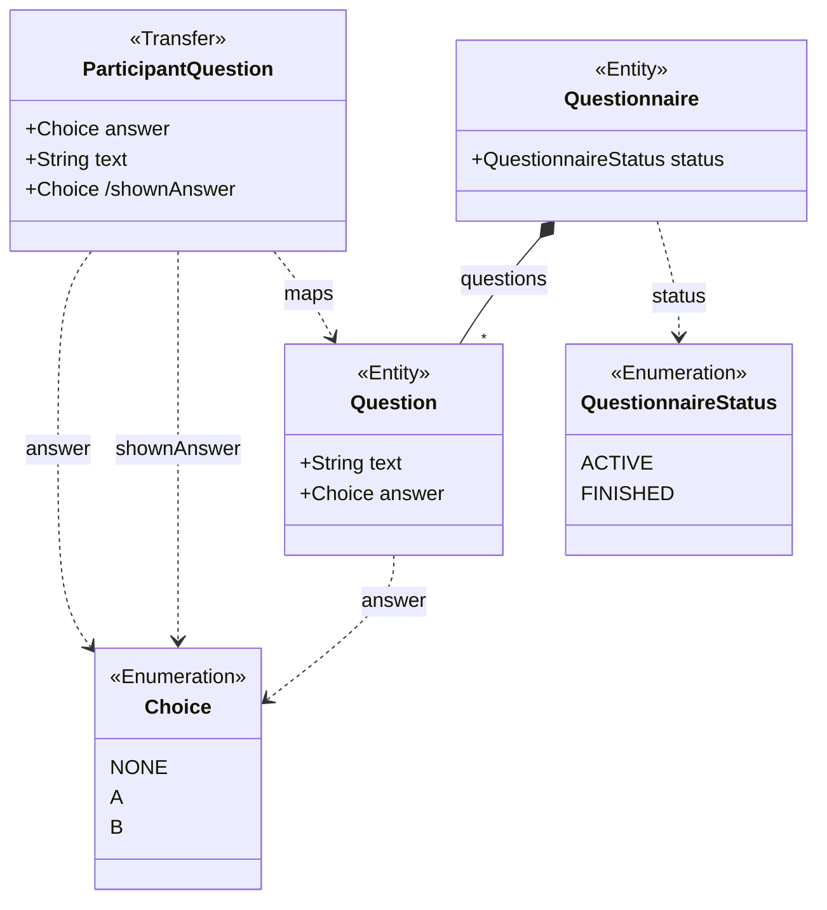

## Intent

Reveal or hide a value through a derived attribute with a conditional (ternary) getter on a transfer object, so the rule is evaluated on the server by the model and no custom code is needed.

## Practice

- A `DERIVED` attribute on a transfer object has a `getterExpression` of the form `condition ? realValue : fallback` ([model-development](../../agent-docs/model/model-development.md), *JQL grammar quirks*).
- The condition must be a logical expression, and both branches must be of the same kind; entity branches resolve to a common supertype.
- The condition typically reads the state of a parent, via `self!container(ParentType).status == Status#VALUE` for a composed child, or the presence of an optional relation, via `self.relation!isDefined()`.
- The fallback is a neutral enum member (`NONE`), an empty value or another source.
- Do not hang the real value on a second mapped member of the same transfer object: expose only the conditional one to the client, otherwise the value leaks.

## Rationale

The expression runs where the data is computed, so a client cannot bypass it, unlike a hidden UI field. This is data-level masking; it is separate from UI-level enabling and hiding with `hiddenBy` / `enabledBy`, which only change what the generated page shows ([UI authoring guide](../../agent-docs/model/ui-authoring-guide.md)). Derived attributes are read-only. Complex conditions that outgrow a single expression belong in an operation or a backend interceptor instead ([interceptors](../../agent-docs/backend/interceptors.md)).

## Example

A questionnaire has questions composed in it. `ParticipantQuestion` is a transfer object mapped to the question entity. Its derived `shownAnswer` returns the answer only when the owning questionnaire is finished and `NONE` otherwise: the getter is `self!container(Questionnaire).status == QuestionnaireStatus#FINISHED ? self.answer : Choice#NONE`.

Another seen variant switches between a guest's and an owner's data depending on whether a guest relation is defined, giving one polymorphic display attribute.

## When to avoid

- When the rule depends on who is asking: use access getters or actor variables instead, see [[derived-access-filtering]].
- When the condition needs several steps or external data.

## Related

- [[enum-state-machine]] — the status that usually drives the condition
- [[derived-attribute-flattening]] — other derived attribute shapes
- [[composition-ownership]] — `!container()` needs a composition

## Structure diagram

