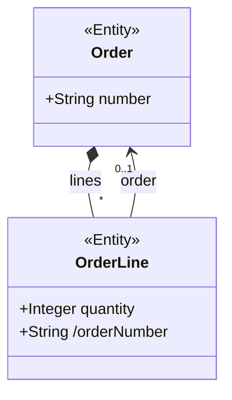

## Intent

Let a composed child reach its parent without a stored foreign key, either through a derived relation to the parent or inline with `!container()`.

## Practice

- `!container(type)` returns the container of an instance when it is part of a `COMPOSITION` ([model-development](../../agent-docs/model/model-development.md), *Reference Functions*).
- Inline form: a derived attribute on the child such as `self!container(Order).number`.
- Relation form: a derived relation on the child, typed as the parent with cardinality `0..1`, whose getter is `self!container(Order)`. Calling it `container` is only a convention; domain names such as `owner` also occur.
- Both forms are read-only; both need the child to be composed in the parent. For a non-composition link use an ordinary two-way relation instead ([[bidirectional-relation]]).
- A derived relation with upper bound 1 needs its getter to end in a single instance; `!container()` already returns one, so no extra narrowing is needed here (collections would need `!any()`, see [model-development](../../agent-docs/model/model-development.md), *Using `!any()` correctly*).

## Rationale

The parent is already known from the composition, so storing it again duplicates data. The derived form costs a small computation on read and cannot be written. For platform-side code the generated DAO has a matching `queryContainer` for the child (see [interceptors](../../agent-docs/backend/interceptors.md)).

## Example

`Order` composes `OrderLine` (`lines`). On `OrderLine` a derived relation `order` of cardinality `0..1` points back to the order, and a derived `orderNumber` returns `self!container(Order).number`.

Seen in six projects, often for display of parent context on child rows and for filtering by parent state.

## When to avoid

- When the child is not composed: `!container()` does not apply.
- When the child needs to be re-parented or the parent must be settable; use a stored relation.

## Related

- [[composition-ownership]] — the composition that makes this possible
- [[derived-relation-navigation]] — other derived relation shapes
- [[derived-access-filtering]] — access getters over the same data

## Structure diagram

