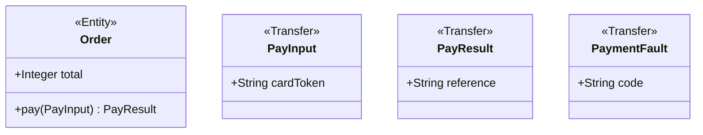

## Intent

Declare an operation in the model with its full signature (input, output, faults) and mark it as custom-implemented when its logic goes beyond what an operation script can express; the behaviour then lives in backend Java.

## Practice

- The operation carries `customImplementation = true`. With `false` the body is a JCL script, validated at design time; with `true` the operation switches to Java and the script is skipped by validation ([operation.md](../../agent-docs/model/esm_metamodel/operation.md), *Operation bodies (JCL) and validation*).
- Declare every fault the Java code may throw in the model; without the declaration the generated interface has no `throws` clause and the build fails ([custom operations](../../agent-docs/backend/custom-operations.md), *Rules for Custom Operations*).
- The generator emits a `.java.default` stub per operation (it throws `UnsupportedOperationException`). Never edit it: create the implementation file next to it and list the stub in `.generator-ignore` ([custom operations](../../agent-docs/backend/custom-operations.md), *Understanding Generated Default Implementations*).
- Interceptors and write guards do not fire for custom operations, so put permission checks inside the implementation ([interceptors](../../agent-docs/backend/interceptors.md)).
- Some projects additionally leave a comment-only body (`// no code`, `// sdk`) on such operations. That is a project habit for readers; the flag, not the comment, decides what runs.

## Rationale

The model stays the single contract: the generated SDK, REST endpoint and page action exist for the operation, while only the behaviour is hand-written. Typical reasons: scoring or evaluation logic, external system calls, document or spreadsheet generation, multi-step workflows with side effects, registration and activation flows.

The cost is the gap between model and code: a placeholder with an empty body can be mistaken for a finished operation, and the generated header can remain on a file that is already implemented, so compare with the `.default` sibling rather than trusting the header.

## Example

`Order` has an instance operation `pay`, flagged as custom-implemented, with input `PayInput`, output `PayResult` and fault `PaymentFault`. The model shows only the signature; the payment logic is in a backend implementation class that implements the generated `pay` interface (project code, not platform).

Seen in eight projects: many custom operations in integration-heavy ones (external API sync, email), a handful in others.

## When to avoid

- When the logic fits a JCL script: keep it in the model so it is validated at design time.
- When the work is only a read or filter: model it as a derived member or access getter.
- Bulk empty placeholders that nobody schedules: they ship as operations that fail at runtime.

## Related

- [[singleton-entity]] — settings and configuration entities often carry such operations

## Structure diagram

