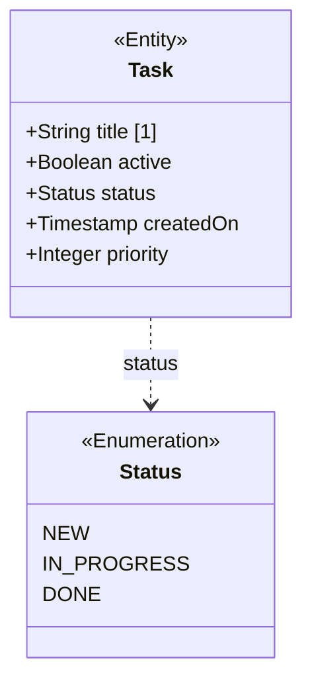

## Intent

Give stored attributes and editable transfer members a `defaultExpression` that sets a sensible initial value on creation.

## Practice

- `defaultExpression` is available on a `STORED` entity member and on `TRANSIENT` or editable `MAPPED` transfer members ([structure.md](../../agent-docs/model/esm_metamodel/structure.md), *DataMember Attribute Rules*); the same applies to relations.
- Common defaults:
  - booleans: `true` for "active", `false` for flags that start unset
  - enums: the first lifecycle state, for example `Status#NEW`
  - sentinel enum member such as `Choice#NONE` for "not chosen yet" (see [[enum-sentinel-value]])
  - numbers: `0` for accumulators, `1` for quantities, a business number such as a quota
  - strings: `"-"` for required text that is computed later
  - temporal: `Timestamp!now()`, `Date!now()`; these read the `SYSTEM` variables ([model-development](../../agent-docs/model/model-development.md))
  - identifiers: a database sequence through `Type!getVariable("SEQUENCE", "Name")`, optionally formatted with `lpad`, see [[sequence-based-identifier]]
  - current user: `!getVariable("ACTOR", "email")` ([[actor-context-variable-lookup]])
- Transfer-level defaults may differ from the entity's: a form can start with `durationDays = 20` while the entity has none.
- An undefined variable resolves to `null` with a warning, so check the variable name.

## Rationale

Defaults remove boilerplate from creation operations and give forms a usable starting state. Enumeration defaults make the initial lifecycle state explicit. Transfer-level overrides let a form differ from the stored default without touching the entity.

The cost is divergence: a transfer default that is not in step with the entity can surprise users. Defaults are conventions on top of the platform's `defaultExpression`; the values chosen are domain decisions.

## Example

A `Task` has a required `title` defaulting to `"-"`, `active` defaulting to `true`, `status` defaulting to `Status#NEW`, `createdOn` defaulting to `Timestamp!now()` and `priority` defaulting to `1`. Its form transfer object `TaskForm` adds a transient `durationDays` with default `20`.

Seen in 16 projects.

## When to avoid

- When the initial state is derived rather than stored, for example from a history trail ([[derived-state-from-history]]); set it in the factory operation instead.
- When a default would hide a missing choice: prefer an explicit sentinel or a required input.
- Do not use defaults to carry business rules; use operations.

## Related

- [[enum-state-machine]] — the default is the initial state
- [[sequence-based-identifier]] — sequence defaults for identifiers
- [[actor-context-variable-lookup]] — defaults taken from the current user
- [[enum-sentinel-value]] — sentinel defaults

## Structure diagram

<!-- mermaid:generated fragment=default-value-patterns cli=1.1.0.20261108_202643_d9769d90_develop -->

<!-- /mermaid:generated -->
