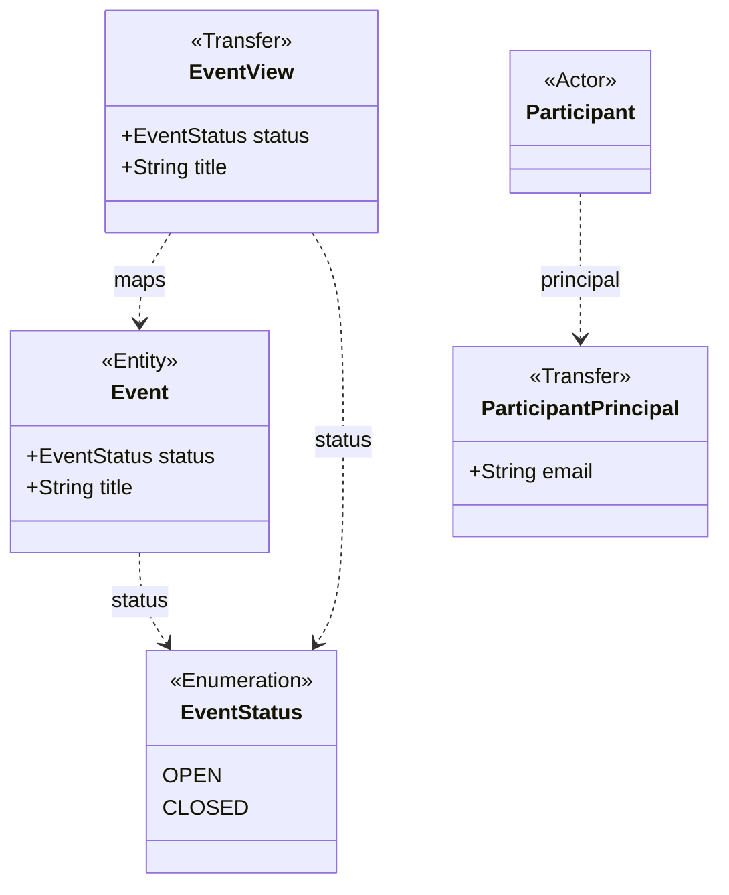

## Intent

Restrict what an actor can reach by giving its access a `DERIVED` type and a getter expression, so visibility is enforced in the model.

## Practice

- An actor access has `accessType` `ALL` or `DERIVED`. `ALL` is fixed to `0..*` and has no getter; `DERIVED` has a configurable cardinality (`0..1` or `0..*`) and a getter ([accesspoint.md](../../agent-docs/model/esm_metamodel/accesspoint.md), *AccessType Behaviour*).
- Getter rules, all at once ([architectural patterns](../../agent-docs/backend/architectural-patterns.md), *Rules for `accesses[*].getterExpression`*):
  - the filter starts from the entity, not from the transfer object
  - `self` is not in scope inside an actor access getter; iterate from the entity with a lambda variable
  - a `DERIVED` access needs an expression that returns references; for "see everything" use `ALL` with no getter
  - `!getVariable(...)` returns a scalar; compare with `==`, and qualify the primitive type
- Typical shapes:
  - status filter: `Event!filter(e | e.status == EventStatus#OPEN)`
  - singleton: an expression ending in `!any()` with cardinality `0..1`
  - ownership: compare an entity field to the actor's own value, for example `!getVariable("ACTOR", "email")`
  - role-scoped: one `!filter` whose lambda disjuncts a role flag and the ownership clause; JQL has no if/else ([advanced modeling patterns](../../agent-docs/model/advanced-modeling-patterns.md), *Role-scoped access getters*)
- Inside a derived attribute on the principal's own transfer object, `self` is the actor's row (used for flags such as `isNotAdmin`); that is a different place from the access getter.
- Admin actors commonly use `ALL`.
- `isActiveExpression` on the actor decides whether the actor may log in, a separate switch from access filtering.
- Treat the filter as a read-side restriction and verify direct access by identifier: a signed identifier is a JWS with subject = identifier and claims entity type, version and issuer (the reference or operation that produced it); it carries no user or actor claim, and verification only checks that the type matches. Do not assume that opening another actor's record by its page address is refused. *Verify* with the dispatcher, and enforce ownership in the model or in a write/read guard (interceptor or checks inside custom operations).

## Rationale

The filter runs in the generated query, so a client never receives rows outside it from list or query reads, and no custom code is needed. Direct reads by signed identifier are a separate case (see Practice). Limits: the expression language has restrictions (no nested lambda scopes, multi-value claims cannot be consumed, `!any()` at most once); when a rule does not fit, compute it in a backend interceptor into a transient attribute ([interceptors](../../agent-docs/backend/interceptors.md)). Access filtering is a model rule; it does not protect custom operations.

## Example

`Participant` actor has two accesses to `EventView`, a transfer object mapped to `Event`: `allEvents` of type `ALL` and `openEvents` of type `DERIVED` with getter `Event!filter(e | e.status == EventStatus#OPEN)`, cardinality `0..*`.

Seen in 13 projects, mostly for status, ownership and singleton accesses.

## When to avoid

- When the actor should see everything: use `ALL`.
- When visibility depends on logic JQL cannot express: use a custom service or interceptor.
- Do not rely on a UI filter alone for security.

## Related

- [[actor-based-transfer-projection]] — what shape the actor receives
- [[singleton-entity]] — the singleton access shape
- [[range-expression-filtering]] — filtering choices for relation selectors
- [[container-back-reference]] — navigation used inside filters

## Structure diagram

