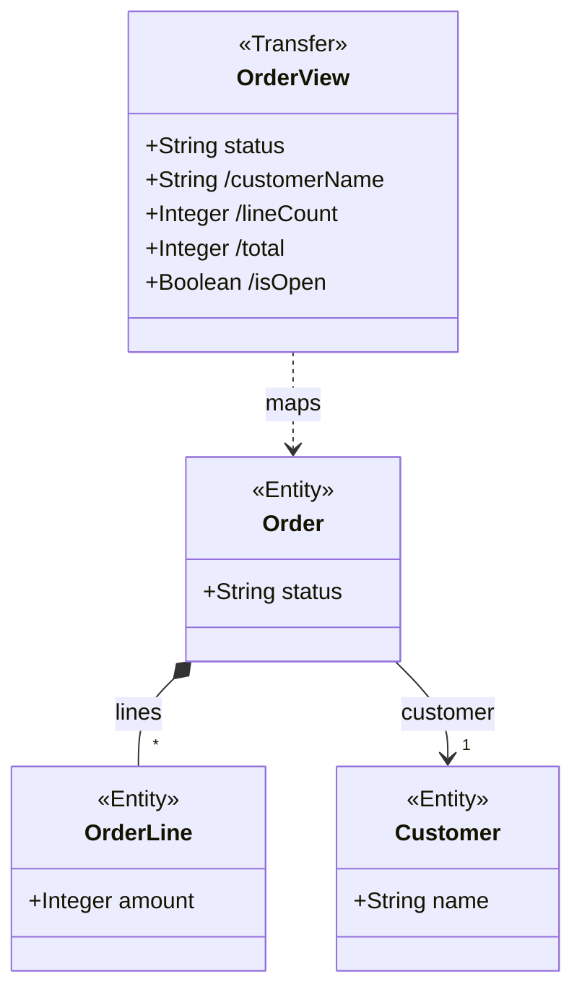

## Intent

Compute values from related data into `DERIVED` attributes on a transfer object so clients get flat, ready-to-show fields instead of walking relations.

## Practice

- A derived attribute has `memberType = DERIVED` and a `getterExpression`; it is read-only ([structure.md](../../agent-docs/model/esm_metamodel/structure.md), *DataMember Attribute Rules*).
- Shapes (functions are listed in [model-development](../../agent-docs/model/model-development.md), *Reference Functions*):
  - relation-to-value: `self.customer.name`; multi-hop: `self.question.category.name`
  - aggregate: `self.lines!count()`, `self.lines!sum(l | l.amount)`
  - boolean: `self.status == Status#CLOSED`
  - string building with `+`
  - difference or date arithmetic on fields
  - parent value: `self!container(Parent).attribute` ([[container-back-reference]])
  - conditional: a ternary expression ([[conditional-visibility-getter]])
- A lambda takes one iterator variable and selects an immediate field; nested lambdas do not see `self`.
- Avoid pointing a derived attribute at another derived attribute: chains of derived members can be slow.
- Collection-valued selections that must collapse to one value need `!head()` after `!sort`, or `!any()`.

## Rationale

The platform evaluates the expression in the query, so values are always current and nothing is stored twice. Clients do not need the relation, which keeps transfer objects small and pages simple. The trade is a computation per read, and the value cannot be edited or filtered the way a stored one can ([[aggregated-stored-field]] stores it instead).

## Example

`OrderView` maps `Order` and adds derived `customerName = self.customer.name`, `lineCount = self.lines!count()`, `total = self.lines!sum(l | l.amount)` and a boolean `isOpen` from the status. Entities can hold derived members too; transfer-level ones are the usual place for display values.

Seen in 17 projects.

## When to avoid

- When the value is read very often in large lists: consider a stored denormalised field ([[aggregated-stored-field]]).
- When a derived value would have to be edited: derived attributes are read-only.
- When a literal is enough: [[literal-derived-attribute]].

## Related

- [[actor-based-transfer-projection]] — per-actor transfer shapes carry these attributes
- [[literal-derived-attribute]] — constant derived values
- [[derived-relation-navigation]] — the relation counterpart
- [[aggregated-stored-field]] — stored alternative

## Structure diagram

<!-- mermaid:generated fragment=derived-attribute-flattening cli=1.1.0.20261108_202643_d9769d90_develop -->

<!-- /mermaid:generated -->
