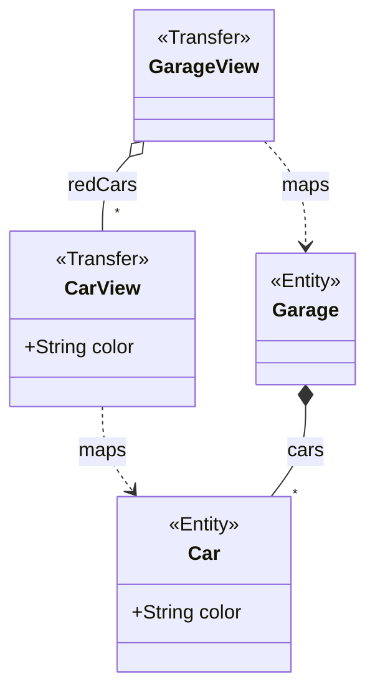

## Intent

Know that a filtered path protects its own membership: you cannot edit a row through a filtered derived relation or derived access in a way that moves it out of the filter. Plan state transitions (draft to published, red to blue) on a path that does not carry the filter.

## Practice

### The rule

An update through a derived relation, or through an actor `Access` with a `getterExpression` filter, is rejected with a validation error when the post-update state no longer satisfies the filter predicate. The update is aborted and the row is unchanged. Attributes that the filter reads are therefore read-only through the filtered path. The access reference states this rule ([accesspoint reference](../../agent-docs/model/esm_metamodel/accesspoint.md), *Access*, `getterExpression`).

- Derived relation on a transfer object, filtered by a predicate on the target's attribute: updating that attribute so that the row falls outside the predicate fails.
- Derived access with the same kind of filter: same result.
- Where this sits among the other relation capabilities: see [[relation-driven-crud-with-custom-input]] (project capability ladder, rung 5).

### How it differs from read-side scope

Two independent rules apply to the same filtered path:

| Side | Trigger | Behaviour |
|---|---|---|
| Read | list | The filter is evaluated when the list is built. Out-of-scope rows never appear, so the caller never gets a signed identifier for them. |
| Write | update | The post-update state must satisfy the filter. |

Refresh and update of a single instance take the signed identifier from an earlier response and do not re-evaluate the access getter. Scope is enforced at list time, because a caller never obtains a signed identifier for a row outside the scope ([platform behavior reference](../../agent-docs/backend/platform-behavior-reference.md), *Signed Identifiers*; the testkit blueprint records the same as the "bypass note", see [[testkit-integration-foundation]]). The agent-docs do not say whether a custom operation or a direct entity DAO write is checked against the filter; the project notes say they bypass it (*verify*).

### Ways to change the filtered attribute

Project practice, three options:

1. **An unfiltered access.** Add a second access to the same target without the filter (or with a broader one) and write through it. Keep the filtered access for scoped display.
2. **A custom operation** on the parent or the entity. The operation body writes the row through the entity (or an unfiltered path), and its availability can be guarded with `enabledBy`. Return the transfer object that suits the destination (see [[operation-return-type-navigation]]). Interceptors never run around custom operations, so put required checks in the body.
3. **State-based partitioning:** one mapped transfer object per state group, with a custom operation that flips the state and returns the destination group's object ([[state-based-transfer-partitioning]]).

## Rationale

- The invariant keeps a filtered view honest: a row cannot vanish from the list because of an edit made in that same list.
- Knowing it up front avoids a model where a filtered access is the only way to publish, approve or recolour its rows.
- Filtered derived relations and filtered accesses behave the same way, so one rule covers both.

## Example

A garage has cars. The garage view has a derived relation `redCars` that filters the cars by colour equal to red. The car view is updateable. Editing a red car's colour to blue through `redCars` is rejected, because the post-update colour fails the filter. To recolour, use an unfiltered cars access, or an operation on the garage that takes the car and the colour.

The same applies to a user's drafts access filtered by status equal to draft: setting a draft's status to published through it is rejected. Publishing goes through an unfiltered letters access, or through a custom operation that returns the published letter's own transfer object. (Observed in compsych-letter-demo.)

## When to avoid

- The path is not filtered (an `ALL` access, a plain mapped relation): there is no membership to protect.
- The filter reads only attributes that are never edited: the rule never triggers, so no workaround is needed.

## Related

- [[state-based-transfer-partitioning]] — write-side state transitions through separate transfer objects
- [[relation-driven-crud-with-custom-input]] — capability ladder, rung 5
- [[derived-access-filtering]] — how derived accesses are filtered
- [[operation-return-type-navigation]] — return type decides where the UI lands after a state change

## Structure diagram

<!-- mermaid:generated fragment=derived-relation-membership-invariant cli=1.1.0.20261108_202643_d9769d90_develop -->

<!-- /mermaid:generated -->
