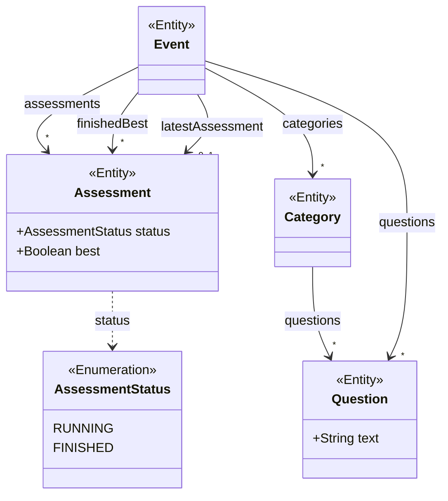

## Intent

Define a relation whose content is computed by a getter expression over other relations, so collections stay in step with their sources without storing them.

## Practice

- The relation has `memberType = DERIVED` and a getter expression; its cardinality is chosen by `upper` (see [type.md](../../agent-docs/model/esm_metamodel/type.md), *Cardinality Conventions*).
- A derived relation with upper bound 1 must end in `!any()` or another single-instance function; a collection (`upper = -1`) takes no suffix. `!any()` may appear at most once ([model-development](../../agent-docs/model/model-development.md), *Using `!any()` correctly*).
- Shapes (functions in the same guide, *Reference Functions*):
  - transitive: `self.categories.questions`
  - filter: `self.assessments!filter(a | a.status == Status#FINISHED and a.best)`
  - sorted head: `self.assessments!sort(a | a.date DESC)!head()`; `!head()` is deterministic only after `!sort`
  - self: `self`, to present the same entity through another transfer
  - container: `self!container(Parent).relation` ([[container-back-reference]])
- Lambdas do not nest and do not see `self` inside; filters comparing to `self` inside a global entity filter fail to build.
- Avoid derived relations built on other derived relations when a short path exists.

## Rationale

A derived relation has no storage, so it cannot go stale. Page tables over it need no extra operations. The cost is read-time work and read-only access: items cannot be added through it. For the single-value case the `!any()` rule is easy to forget and shows up late, at build time.

## Example

`Event` has stored `categories` and `assessments`. Its derived `questions` is `self.categories.questions` (union over all categories), `finishedBest` filters assessments by status and a flag, and `latestAssessment` picks the first of assessments sorted descending.

Seen in 8 projects.

## When to avoid

- When users must add or remove items directly: use a stored relation.
- When the path is long and used everywhere: map it once on a transfer object.
- When the data is only needed in one expression: navigate inline.

## Related

- [[derived-attribute-flattening]] — attribute counterpart
- [[self-referencing-derived-relation]] — `self` as a relation
- [[container-back-reference]] — parent navigation

## Structure diagram

<!-- mermaid:generated fragment=derived-relation-navigation cli=1.1.0.20261108_202643_d9769d90_develop -->

<!-- /mermaid:generated -->
