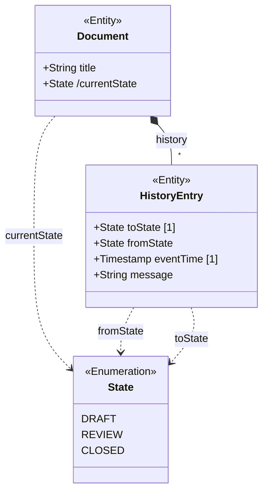

## Intent

Do not store the current lifecycle state; derive it from the newest entry of a composed history collection, so state and audit trail cannot diverge.

## Practice

- The parent has no stored state attribute. It composes a `0..*` collection of history entries ([[composition-ownership]], [[collection-lower-bound-zero]]).
- Each entry records `toState` (required), optionally `fromState`, an `eventTime` timestamp, the acting user and a message.
- The parent has a derived attribute: `currentState = self.history!sort(h | h.eventTime DESC)!head().toState`. `!head()` is deterministic only after `!sort` ([model-development](../../agent-docs/model/model-development.md), *Collection Functions*).
- Workflow operations append a new entry instead of updating a field; the factory operation creates the first entry.
- Entries are immutable: no create/update/delete exposed to clients beyond the operations.

## Rationale

There is one source of truth and every transition is recorded as a side effect. The cost is read-time sorting, history growth, and a more involved model than a stored enum; derived values are also not a good basis for table sorting and filtering (not confirmed in the docs, verify before relying on it).

## Example

`Document` composes `HistoryEntry` items. `HistoryEntry` has required `toState`, optional `fromState`, a required `eventTime` and a `message`. `Document.currentState` is derived from the newest entry. Seen in one project with four workflow operations (request review, accept, reject, close), each appending an entry.

## When to avoid

- When no audit trail is needed or state reads must be fast: use [[enum-state-machine]] with a stored state.
- When the state is filtered or sorted on heavily in lists.
- When history can grow unbounded without archiving.

## Related

- [[enum-state-machine]] — stored alternative with simpler reads
- [[audit-event-entity]] — the history entry is an audit event
- [[composition-ownership]] — entries are composed in the parent
- [[collection-lower-bound-zero]] — the history collection starts empty

## Structure diagram

