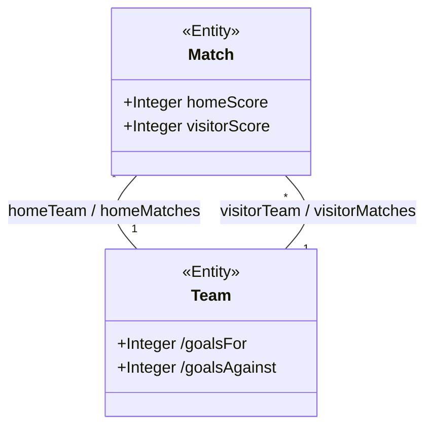

## Intent

An entity sometimes relates to the same target entity type in two distinct roles (a match has a home and a visitor team). Model each role as its own named two-way relation instead of one generic relation plus a role discriminator.

## Practice

### One named relation per role, each with its own reverse collection

- The owning entity declares two relations to the same target, named by role (`homeTeam`, `visitorTeam`), each `1..1` when the role is mandatory.
- Each relation is a two-way relation: the target gets a reverse member per role (`homeMatches`, `visitorMatches`, both `0..*`). Both ends of a two-way relation point at each other through `partner` ([structure reference](../../agent-docs/model/esm_metamodel/structure.md)).
- The reverse end needs a role-specific name. A single shared reverse collection would merge the roles again.
- Keep the relation kind `ASSOCIATION` on both ends. The model validator rejects a two-way relation declared as composition, and requires that at least one end has lower bound 0; the `0..*` reverse end satisfies this ([advanced modeling patterns](../../agent-docs/model/advanced-modeling-patterns.md)).

### Aggregate per role on the target

Derived members of the target navigate each role collection on its own and combine them where needed, for example goals scored by a team: `self.homeMatches!sum(m | m.homeScore) + self.visitorMatches!sum(m | m.visitorScore)`. `!sum` accepts integer and decimal selectors only ([JQL collection functions](../../agent-docs/model/model-development.md)). For optional score fields see [[null-safe-collection-aggregation]].

## Rationale

- Role semantics are in the model, so navigation and aggregation need no filter on a discriminator value.
- Each role collection can be summed, counted or filtered independently, which a single generic relation cannot do without an extra `!filter`.
- Project practice (not platform behaviour): the role prefix on the forward name and the role suffix on the reverse name keep generated pages and expressions readable.
- Cost: more relations on the owning entity and more reverse members on the target.

## Example

`Match` has two mandatory relations to `Team`: `homeTeam` and `visitorTeam`. `Team` has `homeMatches` and `visitorMatches`. The derived `Team.goalsFor` sums the home score over home matches plus the visitor score over visitor matches; `goalsAgainst` swaps the two scores. The entities and names are neutral stand-ins for the original sports-league model.

## When to avoid

- The roles are not fixed or there may be many of them: use a link entity that carries a role attribute.
- Only one role ever matters: a single relation is enough.
- No per-role reverse navigation or aggregation is needed: a one-way relation per role is simpler than a two-way pair.

## Related

- [[bidirectional-relation]] — the two-way relation this pattern repeats per role
- [[derived-attribute-flattening]] — derived members that read the role collections
- [[null-safe-collection-aggregation]] — safe sums over optional fields

## Structure diagram

<!-- mermaid:generated fragment=dual-role-relation cli=1.1.0.20261108_202643_d9769d90_develop -->

<!-- /mermaid:generated -->
