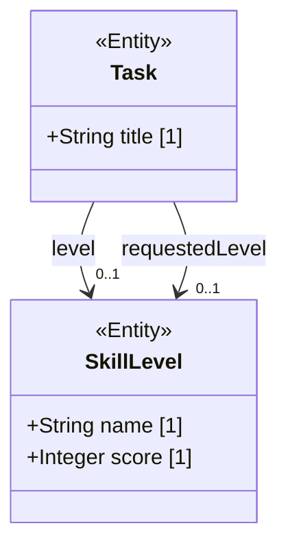

## Intent

A classification (level, grade, category) must be extensible after deployment. Instead of an enumeration, keep the values as rows of a small entity that other entities reference.

## Practice

### Model the values as an entity with a sortable attribute

- A lookup entity holds a required `name` and, when the order matters, a required `score` or sort key. Other entities reference it with a `0..1` or `1..1` relation instead of an enum-typed attribute.
- Rows are created by a seeding step at startup (see [[initializer-operation]]) and later by authorised actors through an Access with create/update permission.
- Offer the values in selectors through a range expression on the relation, sorted by the key, for example `Level!sort(l | l.score ASC)` ([[range-expression-filtering]]). The UI shows a picker that looks like an enum drop-down.

### Know what you give up compared to an enumeration

- An enumeration is a platform type with literals (`Type#VALUE`) that expressions and operation bodies can name directly. A row has no literal: a rule that depends on a particular value has to look it up by name or key.
- Enumeration members persist by their ordinal ([ordinal rules](../../agent-docs/model/esm_metamodel/type.md)). Rows have an identity and can be renamed or deleted, so give rows that are referenced by code a stable key attribute.
- Deleting a referenced row needs a guard (see [[guard-clause-delete]]).

## Rationale

- New values need no model change, no regeneration and no deployment: only data changes.
- Values can carry data (score, description, colour) and be managed from the UI.
- Practice note (not platform behaviour): the original project used an entity for levels that administrators extend and a true enumeration for a stable scale, deciding per classification.
- Cost: no compile-time safety, a seeding step, and a relation join instead of a literal.

## Example

A `SkillLevel` entity has `name` and `score`, both required. A `Task` references it twice, as `level` and `requestedLevel`, both `0..1`. The selector range of both relations is `SkillLevel!sort(l | l.score ASC)`. Names are neutral stand-ins for the original skill-matrix model.

## When to avoid

- The set is fixed and known at design time: use an enumeration ([[category-enum-pattern]]).
- Logic branches on individual values: a literal is safer than a name lookup.
- Nobody will maintain the rows: the extensibility is then unused cost.

## Related

- [[category-enum-pattern]] — fixed enumeration alternative
- [[initializer-operation]] — seeds the initial rows
- [[range-expression-filtering]] — sorted selector options over the rows
- [[guard-clause-delete]] — protect referenced rows

## Structure diagram

