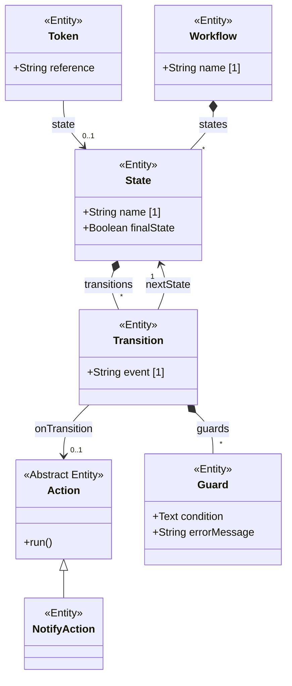

## Intent

Workflows whose states and transitions must be configurable at runtime cannot use an enumeration, because enum members are fixed in the model. Model states, transitions, guards and actions as entities and track the current position per workflow instance.

## Practice

### Entities of the engine

- `State`: a position in the workflow (name, flags such as a final state). It owns its outgoing `Transition` rows through a composition.
- `Transition`: connects to the next `State` by an association, owns its `Guard` rows by composition and may reference an `Action`.
- `Guard`: holds a condition and the error message shown when it fails.
- `Action`: an abstract entity with a custom-implemented instance operation `run`; concrete actions are generalizations that implement it ([[generalization-base-entity]]).
- `Token`: references the current `State` of one running instance (`0..1`).
- A versioned container (here `Workflow`) owns the states by composition, so a new version replaces the whole graph ([[composition-ownership]]).

### The engine lives in operation code

The model holds data only. Moving a token, evaluating a guard and calling an action's `run` is custom operation code ([[custom-implementation-placeholder]]). Declare a fault on the operation so a failed guard reaches the client as a modeled fault ([error handling guide](../../agent-docs/backend/error-handling-guide.md)). Guard conditions stored as text are interpreted by your own code, not by the platform's JQL engine.

## Rationale

- States and transitions are data, so they can be uploaded or edited without changing the model.
- Guards, actions and roles per transition give room for join states, approvals and audit through tokens.
- Project practice (not platform behaviour): the source project loaded the state graph from a configuration file and ran it from custom operations.
- Cost: a much larger model and a hand-written engine, and the compiler no longer checks state names.

## Example

`Workflow` owns `State` rows; each `State` owns `Transition` rows with a `nextState`, `Guard` rows and an optional `Action`. `Action` is abstract with `run`; `NotifyAction` extends it. A `Token` references the current `State`. Names are neutral stand-ins for the original workflow engine.

## When to avoid

- States are few, fixed and known at design time: use [[enum-state-machine]].
- The current state is better derived from an event trail: see [[derived-state-from-history]].
- Nobody will edit the workflow at runtime.

## Related

- [[enum-state-machine]] — simpler alternative for fixed states
- [[generalization-base-entity]] — abstract `Action` with concrete subtypes
- [[composition-ownership]] — states under a version, transitions under a state
- [[custom-implementation-placeholder]] — the engine operations
- [[derived-state-from-history]] — state taken from an event trail

## Structure diagram

<!-- mermaid:generated fragment=entity-based-state-machine cli=1.1.0.20261108_202643_d9769d90_develop -->

<!-- /mermaid:generated -->
