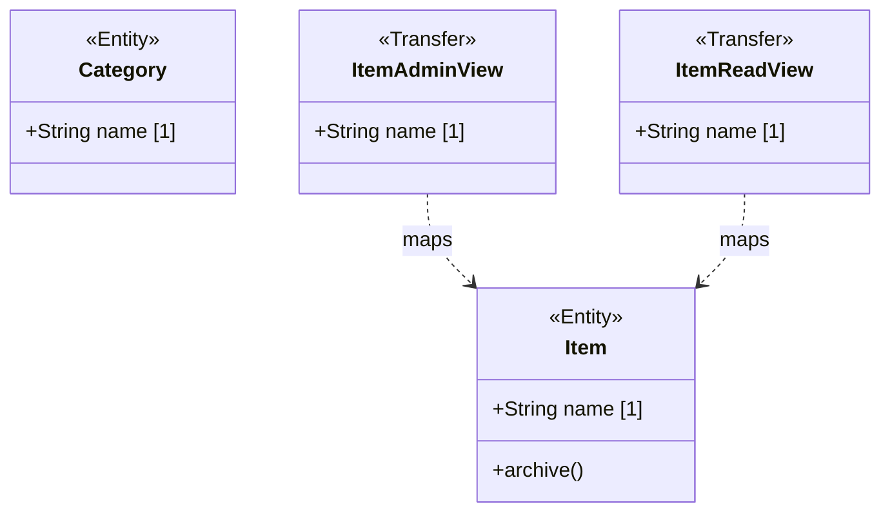

## Intent

Keep create, update and delete permissions out of the entity layer. Entities declare no mutation rights; each actor receives exactly the rights it needs through its own transfer objects and Access entries, and business changes go through operations.

## Practice

### Entities closed, transfer objects and accesses open

- The platform defines `createable`, `updateable` and `deleteable` on entities ([structure reference](../../agent-docs/model/esm_metamodel/structure.md)), on transfer objects, on relations and on Access entries ([accesspoint reference](../../agent-docs/model/esm_metamodel/accesspoint.md)). Practice note: set all three to false on every entity and decide per transfer object and per Access.
- A transfer object maps one entity. Give the actor that may edit a mutable view (`createable`/`updateable` as needed) and everyone else a read-only view of the same entity.
- The Access entry carries the actor's own flags. The same entity can be fully editable for an administrator and read-only for a member, without any entity change.
- Read is nearly always allowed; the write flags vary by role. Delete is often left off everywhere in favour of an active flag ([[soft-delete-active-flag]]).
- CRUD flags on relations steer the generated pages and endpoints: a relation without create, update or delete flags does not get the matching create, update or delete actions in the UI ([UI mapping of relation flags](../../agent-docs/frontend/model-screen-layout.md)). A parent relation's `updateable` and `deleteable` flags also decide what can be done on the element reached through it.

### Business changes go through operations

State changes (approve, close, archive) are operations on the entity or the transfer object, not field edits. An operation can check the state and the actor before it changes anything. The generated DAO itself emits create, update and delete for mapped, non-abstract transfer object types ([data access guide](../../agent-docs/backend/data-access-guide.md)), so backend code is not limited by the flags; the flags govern what the generated API and UI expose to a client. Keep that difference in mind when reasoning about "cannot be created".

### Pair the access with transfer-object design

See [[actor-based-transfer-projection]] for one transfer object per actor role and [[derived-access-filtering]] for narrowing rows. Rights must match across layers: an editable Access on a read-only transfer object offers nothing to edit.

## Rationale

- Permissions live in one place per actor instead of being scattered over entities.
- Different actors can have different rights over the same entity.
- The entity stays a plain storage shape; change rules are explicit operations.
- Cost: more transfer objects, and the entity flags look redundant because they are always false. Practice note (not a platform rule): fifteen source projects followed it; the platform does not require it.

## Example

Entities `Item` and `Category` have all three flags false. `Item` maps to two transfer objects: `ItemAdminView` (create and update on, delete off) and `ItemReadView` (all off). `Item` has an instance operation `archive` for the business change. An administrator actor would point its Access at `ItemAdminView`, a member actor at `ItemReadView`. The diagram shows the entities, transfer objects and operation; the actor and accesses are described here only. Names are neutral stand-ins.

## When to avoid

- A throwaway prototype where generated entity pages are enough.
- Entities that are never exposed to a client (backend-only data): flags have no audience.
- Mixing styles: if some entities allow direct CRUD, document which and why, otherwise reviewers cannot tell a gap from a decision.

## Related

- [[actor-based-transfer-projection]] — one transfer object per actor role
- [[derived-access-filtering]] — row-level scoping on the Access
- [[soft-delete-active-flag]] — delete replaced by an active flag

## Structure diagram

<!-- mermaid:generated fragment=entity-crud-at-service-layer cli=1.1.0.20261108_202643_d9769d90_develop -->

<!-- /mermaid:generated -->
