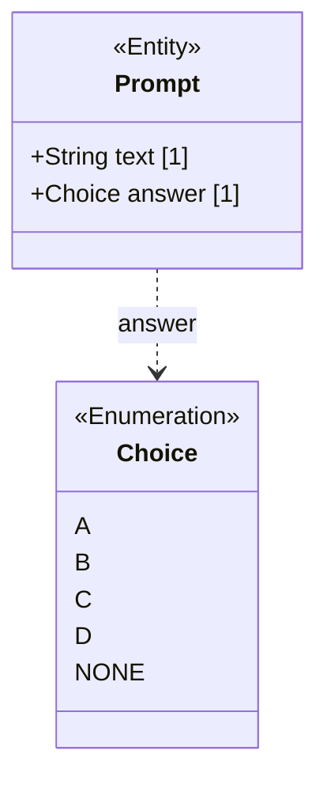

## Intent

An enumeration-typed attribute needs a value for "not set" or "hidden". Add a sentinel member such as `NONE` or `UNKNOWN` to the enumeration instead of leaving the attribute empty.

## Practice

### Add a sentinel literal and use it as the default

- Declare the sentinel as a normal member of the enumeration. Members persist by ordinal and ordinals are unique, 0 to 9999 in JSL models ([ordinal rules](../../agent-docs/model/esm_metamodel/type.md)). Put the sentinel last and never renumber existing members.
- Enumeration literals are written `Type#VALUE` in JQL. Use the sentinel as the attribute's default expression, for example `Choice#NONE`, so a new row never holds an empty value ([[default-value-patterns]]).
- Make the attribute required when "no value" is represented by the sentinel: required plus a default means readers never meet a null.

### Use the sentinel to hide a value

A derived getter returns the real value only when allowed and the sentinel otherwise: `condition ? realValue : Choice#NONE`. Consumers see "no value" instead of the secret ([[conditional-visibility-getter]]).

### Handle it in logic and screens

The sentinel is a real member. Switches, counts and drop-downs include it unless excluded: filter it out of selectors where users must not pick it, and treat it explicitly in state logic ([[enum-state-machine]]).

## Rationale

- "No value" is typed and visible in expressions, so no null handling is needed.
- It works as a default and in conditional getters.
- Practice note (not platform behaviour): two source projects used it for unanswered choices and for an undetermined classification.
- Cost: one extra member that every consumer has to treat; statistics may count it by mistake.

## Example

`Choice` has members A, B, C, D and `NONE` (ordinal 4). `Prompt.answer` is a required `Choice` with default `Choice#NONE`. A derived participant-side view returns `NONE` until the test is finished. Names are neutral stand-ins.

## When to avoid

- The attribute can simply be optional and null is acceptable to every consumer.
- The sentinel would appear as a legitimate choice in selectors and confuse users.
- The enumeration is used in a state machine where "none" is not a state.

## Related

- [[conditional-visibility-getter]] — returns the sentinel to hide a value
- [[enum-state-machine]] — lifecycle enumerations where a sentinel is usually wrong
- [[default-value-patterns]] — default expressions in general

## Structure diagram

<!-- mermaid:generated fragment=enum-sentinel-value cli=1.1.0.20261108_202643_d9769d90_develop -->

<!-- /mermaid:generated -->
