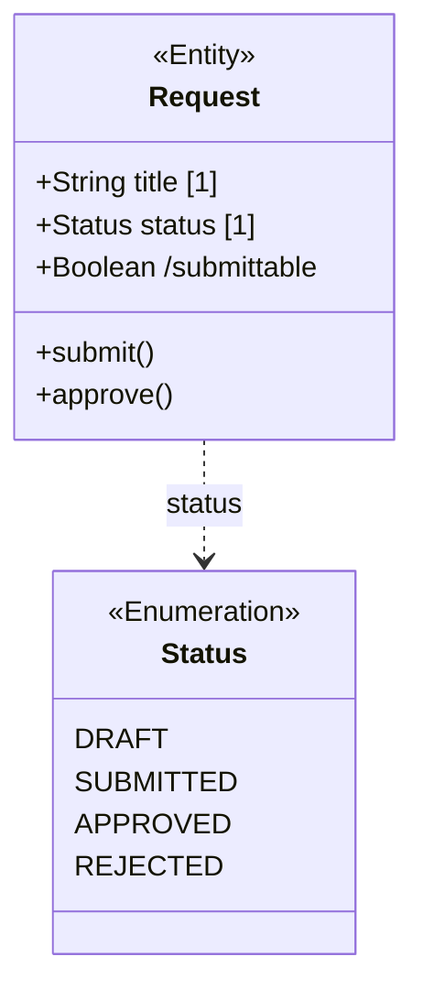

## Intent

Represent a lifecycle with a required enumeration-typed `status` attribute. Each member is a state, and named operations perform the allowed transitions.

## Practice

### Status attribute with an initial default

- The entity has a required `status` attribute typed by a dedicated enumeration. Members persist by ordinal, so add new states at the end and never renumber ([ordinal rules](../../agent-docs/model/esm_metamodel/type.md)).
- The default expression names the initial state with the literal syntax `Type#VALUE`, for example `Status#DRAFT` ([[default-value-patterns]]).
- Several entities can each carry their own status enumeration; a shared enumeration works when the states really are the same.

### Transitions are operations

- Each transition is a named instance operation (`submit`, `approve`) that sets `status`. The platform has no built-in transition table or guard: the operation body, written in JCL or as a custom Java implementation, checks the current state and rejects invalid moves ([JCL scripts](../../agent-docs/model/jcl-operation-scripts.md), [[custom-implementation-placeholder]]).
- Declare a fault on the operation for a refused transition so the client gets a typed business error ([error handling guide](../../agent-docs/backend/error-handling-guide.md), [[error-code-enum-pattern]]).
- A client can call any operation the API exposes, so state checks belong in the operation, not only in the UI.

### Derived booleans drive the UI

Derived booleans computed from the status (`submittable = self.status == Status#DRAFT`) feed `enabledBy` and `hiddenBy` of buttons on the same transfer object ([[conditional-visibility-getter]]). Combine the state with the actor's ownership in the expression when needed.

### Known generated-DAO limit

In backend code, `query<Attribute>()` on an enumeration attribute can fail with a `ClassCastException` because the runtime delivers the ordinal. Read the status through the DTO instead ([known issues](../../agent-docs/backend/data-access-guide.md)).

## Rationale

- The lifecycle is explicit in the model and checked at build time (literals are validated).
- Transitions are ordinary operations, easy to secure per actor.
- Practice note (not platform behaviour): twelve source projects model lifecycles this way; some derive the state from history instead ([[derived-state-from-history]]).
- Limit: no guard conditions or actions beyond what the operation code does; adding a state needs a model change.

## Example

`Request` has a required `status` of enumeration `Status` (DRAFT, SUBMITTED, APPROVED, REJECTED), default `Status#DRAFT`, a derived boolean `submittable`, and two instance operations `submit` and `approve` that move the status. Names are neutral stand-ins.

## When to avoid

- States and transitions must be configurable at runtime: use [[entity-based-state-machine]].
- The state is better derived from an event trail ([[derived-state-from-history]]).
- Only two states with no transition rules: a plain boolean may do.

## Related

- [[conditional-visibility-getter]] — derived booleans from the status
- [[default-value-patterns]] — initial state as default
- [[derived-state-from-history]] — state derived from history
- [[entity-based-state-machine]] — runtime-configurable alternative
- [[error-code-enum-pattern]] — typed refusal of a transition
- [[custom-implementation-placeholder]] — transition bodies in Java

## Structure diagram

<!-- mermaid:generated fragment=enum-state-machine cli=1.1.0.20261108_202643_d9769d90_develop -->

<!-- /mermaid:generated -->
