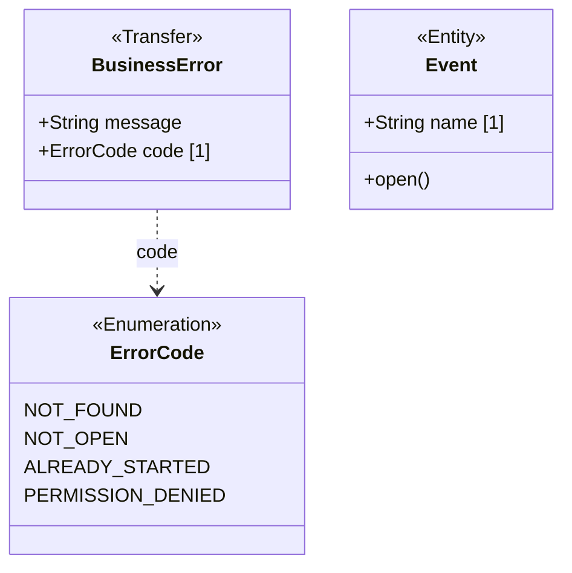

## Intent

Operations that can fail for business reasons should tell the client why in a typed way. Model a fault transfer object that carries a message and an enumeration of error codes, and attach it to every operation that can raise it.

## Practice

### An unmapped fault transfer object with a coded enumeration

- The fault is an unmapped transfer object (here `BusinessError`) with an optional human-readable `message` and a required `code` attribute typed by an `ErrorCode` enumeration. The enumeration lists the domain failure reasons.
- The fault is declared on each operation that may throw it, as a fault parameter with cardinality `1..1` ([operation reference](../../agent-docs/model/esm_metamodel/operation.md)). Without the declaration the generated SDK interface has no `throws` clause, so a custom implementation cannot throw it.
- The SDK generator turns the fault into a checked `<Fault>Exception` with typed details. On the wire the client gets HTTP 422 with the header `X-Fault: <fault FQN>` and the details in the body ([error handling guide](../../agent-docs/backend/error-handling-guide.md)). The exception class name exists only because your model defines this fault; it is not a platform class.
- Thrown from an interceptor, the fault cannot be used directly: wrap it in `InterceptorCallBusinessException` with the fault's FQN as `type` ([interceptors](../../agent-docs/backend/interceptors.md)).
- The frontend fault dialog translates the fault's attributes with keys `faults.<fault FQN>.<attribute>`, so give the enumeration members translatable labels.

### One fault type, many codes

A single fault (`BusinessError`) with an enumeration serves many operations: the client branches on `code` instead of parsing messages. Group the codes by cause (not found, permission, configuration, external system). When codes belong to one actor only, place the fault and enumeration in that actor's package.

### Keep the codes and the throwing code in sync

The enumeration is model data; adding a reason needs a model change and a regeneration, and a code that no operation throws is dead weight. Members persist by ordinal, so append and do not renumber.

## Rationale

- Clients get a stable, typed contract for failures instead of message strings.
- Declared faults give the generated SDK a checked exception, so callers must handle it.
- Practice note (not platform behaviour): four source projects used one shared fault with an error-code enumeration; the platform also supports one fault type per failure.
- A validation problem on one input field is better reported as a `ValidationException`; use a fault for a business rule that deserves its own handling.

## Example

`BusinessError` is an unmapped transfer object with `message` and a required `code` of type `ErrorCode` (NOT_FOUND, NOT_OPEN, ALREADY_STARTED, PERMISSION_DENIED). The instance operation `Event.open` declares `BusinessError` as its fault and is implemented in Java, where it throws the generated exception with the code `NOT_OPEN` when the event is not open. Names are neutral stand-ins. The diagram shows the entity, the enumeration and the fault on the operation.

## When to avoid

- A failure that needs different details per case: model separate faults with their own attributes.
- Field-level input validation: use validation exceptions.
- A single operation with one failure reason: one dedicated fault is enough.

## Related

- [[unmapped-transfer-dto]] — the fault is an unmapped transfer object
- [[enum-state-machine]] — refused transitions are a typical fault source

## Structure diagram

