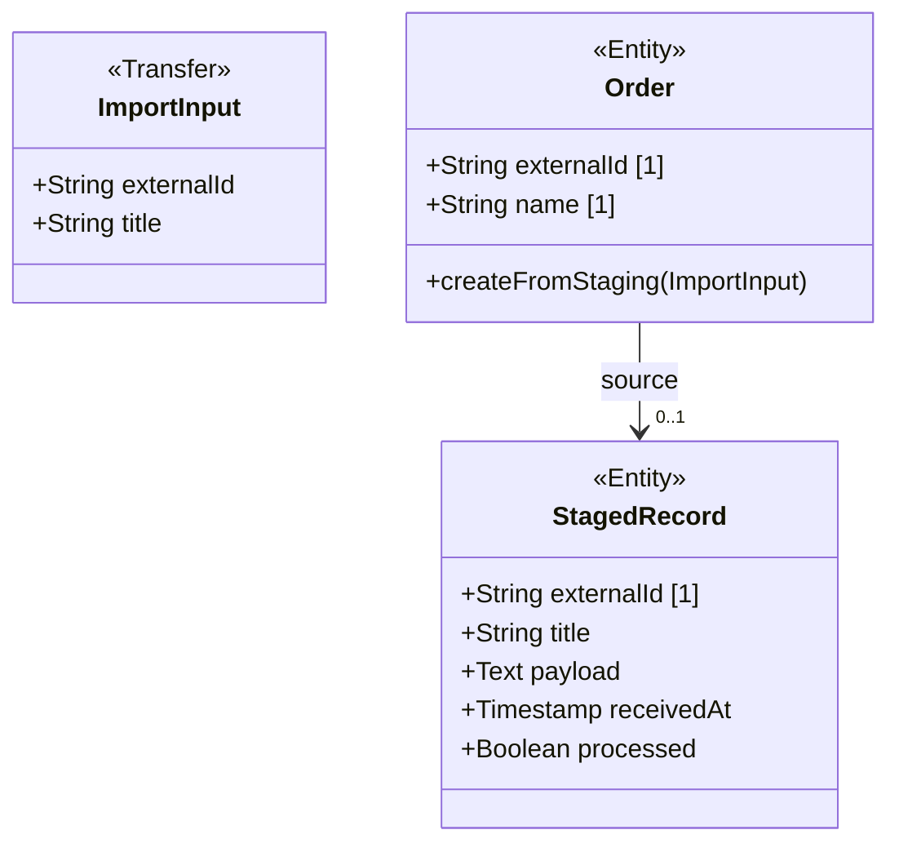

## Intent

Data received from an external system should not go straight into domain entities. Land it in a dedicated staging entity that mirrors the external format, then validate, deduplicate and transform it into domain entities with explicit operations.

## Practice

### A flat staging entity that mirrors the source

- The staging entity uses simple attribute types (String, Text, Timestamp, Boolean) and the external system's own field names, with no domain enumerations or relations. It carries an `externalId` and optionally a received timestamp and a processed flag for synchronization.
- It holds no business logic. Keeping the raw record allows audit and reconciliation.
- The staging row and the domain row stay separate even when they look alike: external naming and shape changes must not leak into the domain model.

### Operations turn staging data into domain data

- A static operation on the domain side takes the external payload as an unmapped input transfer object ([[unmapped-transfer-dto]]) and creates or updates the domain entity ([JCL scripts](../../agent-docs/model/jcl-operation-scripts.md); the body may be custom Java instead).
- Deduplicate by the external id before creating, for example `Order!filter(o | o.externalId == input.externalId)!empty()` ([JQL collection functions](../../agent-docs/model/model-development.md)).
- Route by an organisational identifier when several units own the data.
- A relation from the domain entity back to the staging row (`0..1`) keeps the link for traceability.
- Fetching from the external system is custom operation or scheduled code. The platform has no integration feature for it; see [[initializer-operation]] for the startup hook some projects use.

## Rationale

- External format changes are absorbed in one entity and one operation.
- Deduplication and validation happen at one boundary.
- Project practice (not platform behaviour): two source projects used staging for a road-inspection API, an advertising-platform API and a tax-authority lookup.
- Cost: an extra entity, a transformation step and possibly stale staging rows to clean up.

## Example

`StagedRecord` has `externalId` (required), `title`, `payload` (Text), `receivedAt` and `processed`. `Order` has `externalId` and `name`, a `0..1` relation `source` to the staging row, and a static operation `createFromStaging` taking an unmapped `ImportInput`. The operation skips a record whose external id already exists. Names are neutral stand-ins for the original integrations.

## When to avoid

- The external data already has the domain shape and needs no checks: write it directly.
- The data is read live and never stored.
- A one-off import: a seeding operation is enough.

## Related

- [[unmapped-transfer-dto]] — input transfer object for the external payload
- [[initializer-operation]] — startup seeding and synchronization hook
- [[category-enum-pattern]] — classify the source system of a record

## Structure diagram

<!-- mermaid:generated fragment=external-system-staging-entity cli=1.1.0.20261108_202643_d9769d90_develop -->

<!-- /mermaid:generated -->
