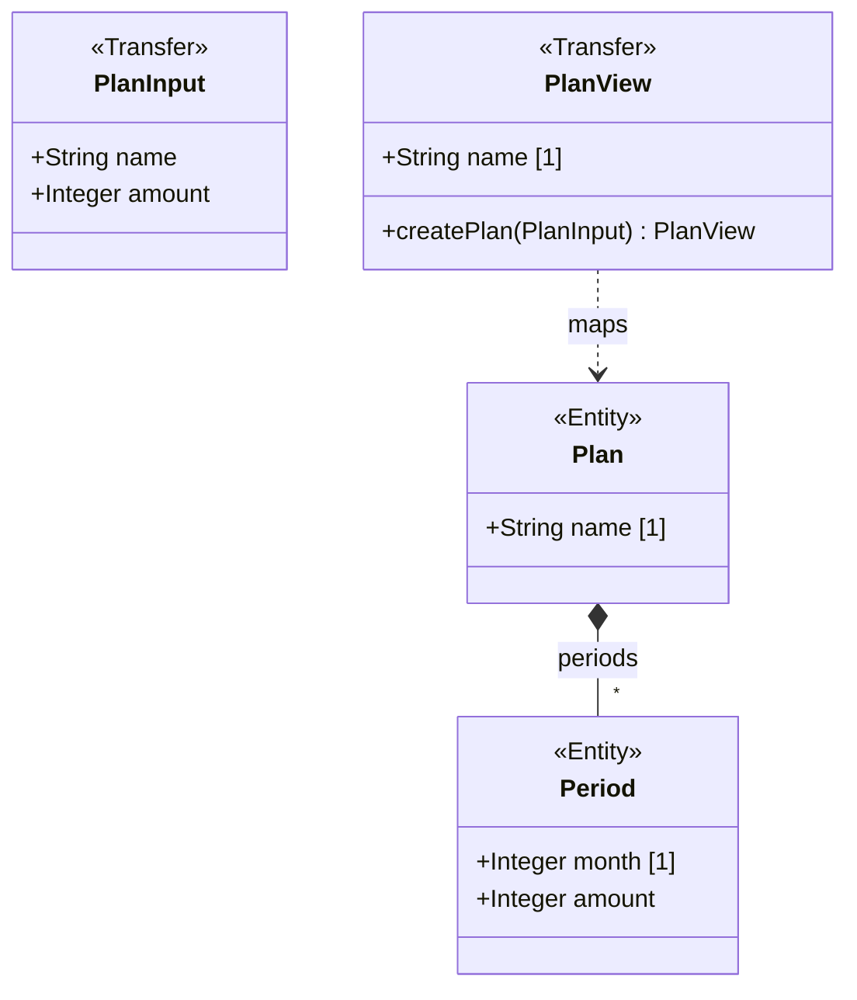

## Intent

Creating some entities must also create a fixed set of child rows (twelve monthly rows, an initial history entry). Put that rule in one static factory operation on a transfer object instead of in every client.

## Practice

### A static operation with an unmapped input and a typed output

- The factory is a static operation on a transfer object. Its input is an unmapped transfer object with the creation parameters; its output is the created entity's transfer type. Operation types, including `INITIALIZER` (a static operation without input), are described in the [operation reference](../../agent-docs/model/esm_metamodel/operation.md).
- The body can be a JCL script or custom Java ([JCL scripts](../../agent-docs/model/jcl-operation-scripts.md)). In JCL, `new Type(...)` must list every required attribute and relation, and reference sets are extended with `+=`. The `mutable` operator turns an input relation into an assignable reference.
- The body resolves the current user (see [[actor-context-variable-lookup]] for the `!getVariable("ACTOR", ...)` claim lookup), creates the parent, creates the children in a loop or explicitly, attaches them to the composition and returns the parent.
- Children belong to the parent by composition ([[composition-ownership]]), so the whole graph is created in one call and removed together.

### Transient inputs

If the input carries relations to existing entities (region, category), declare them as transient relations of the input object ([[transient-relation-parameter]]).

## Rationale

- The entity graph is created together or not at all, and the business rule (always twelve children) lives in one place.
- Clients make one call.
- Project practice (not platform behaviour): two source projects used it for a yearly plan with twelve monthly rows and for a document with an initial history entry.
- Cost: the number and shape of children are fixed, and a long body is harder to read.

## Example

`PlanView` (mapped to `Plan`) has a static operation `createPlan` with the unmapped input `PlanInput` (name, amount). The body creates a `Plan`, adds twelve `Period` rows to `periods` with the input amount, and returns the created `PlanView`. The diagram shows the entities and the composition; the operation itself is described here. Names are neutral stand-ins.

## When to avoid

- The children are optional or user-defined: let the client create them.
- The initial data is the same for the whole system: seed it once ([[initializer-operation]]).
- The creation logic needs steps that fit better in a Java service: use a custom implementation.

## Related

- [[unmapped-transfer-dto]] — the input object
- [[transient-relation-parameter]] — relations in the input object
- [[actor-context-variable-lookup]] — find the current user in the body
- [[composition-ownership]] — children owned by the parent
- [[initializer-operation]] — seed system-wide rows instead

## Structure diagram

<!-- mermaid:generated fragment=factory-operation-with-prepopulation cli=1.1.0.20261108_202643_d9769d90_develop -->

<!-- /mermaid:generated -->
