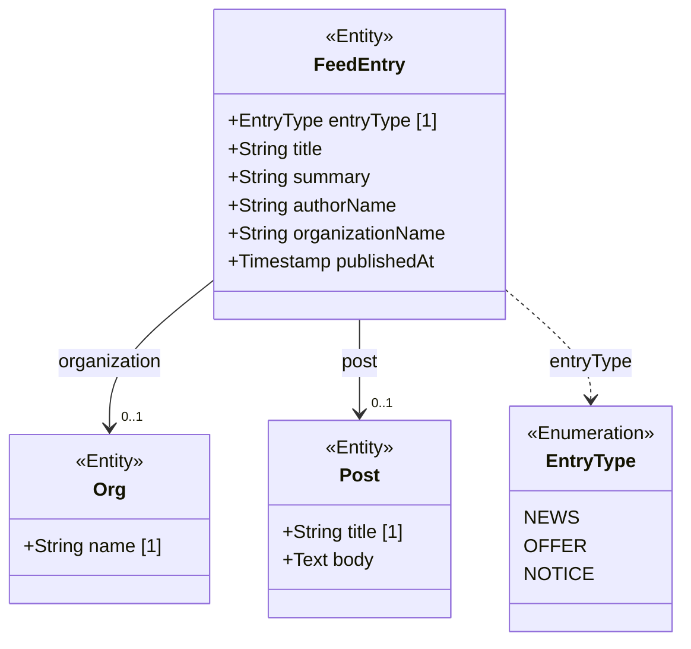

## Intent

A feed or timeline lists items of several entity types. Instead of joining them on every read, keep a read-only entity with a flat copy of the display data, one row per feed item.

## Practice

### A system-managed, flat feed entity

- The feed entity has no create, update or delete rights at entity or transfer-object level (see [[entity-crud-at-service-layer]]): it is changed only by operations.
- It holds denormalized display attributes copied from the sources (title, summary, author name, organisation name, time), a classification enumeration for the item type ([[category-enum-pattern]]) and optional relations (`0..1`) to the source and to the owning organisation for drill-down and filtering.
- Optional display fields get an empty-string default so the UI never renders a null ([[default-value-patterns]]).
- Feed rows are written as a side effect of the source operations (publish, edit, delete) and an admin operation can rebuild them. The platform does not synchronise the copies: the write path is your own operation code.

### Prefer derived members when the data can be read live

A derived member of a transfer object can flatten values from related entities on read ([[derived-attribute-flattening]]). Choose the stored feed entity only when the join cost or the sorting and paging need justify the copies.

## Rationale

- Reads are one flat table: simple sorting, filtering and paging.
- Display shape is decoupled from the source entities.
- Practice note (not platform behaviour): one source project kept a feed table in sync from its publish and delete operations.
- Cost: redundant data, a synchronisation obligation and the risk of stale rows.

## Example

`FeedEntry` has an `entryType` (NEWS, OFFER, NOTICE), `title`, `summary`, `authorName`, `organizationName` and `publishedAt`, plus `0..1` relations `post` and `organization`. It is created with all rights off. An admin operation `syncFeed` on the organisation rebuilds the feed. Names are neutral stand-ins for the original platform.

## When to avoid

- A small data set where a derived member or a query is fast enough.
- The data must always be current: copies lag behind their sources.
- Only one source entity: page that entity directly.

## Related

- [[derived-attribute-flattening]] — flatten on read instead of copying
- [[category-enum-pattern]] — classifies the feed items
- [[default-value-patterns]] — empty-string defaults
- [[entity-crud-at-service-layer]] — read-only entity with operation-driven changes

## Structure diagram

