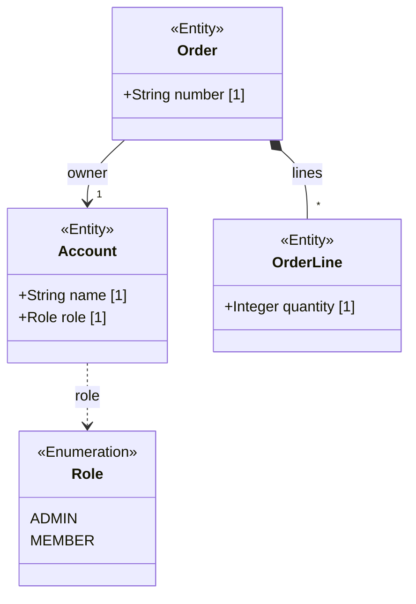

## Intent

Keep every entity concrete and independent: no abstract parents and no inheritance. Variation is expressed through enumerations, composition and different transfer projections.

## Practice

### Concrete entities and variation by other means

- Every entity is concrete and none declares a generalization. Similar entities (two kinds of address, user and administrator) stay separate even when they share attributes.
- Lifecycle variation uses an enumeration-typed status ([[enum-state-machine]]); role variation uses a role enumeration or derived booleans on the actor's own data.
- View variation uses one transfer object per actor role over the same entity ([[actor-based-transfer-projection]]).
- Parent-child ownership uses composition.

### What the platform offers if you need inheritance

Generalization is a platform feature between entity types. An abstract entity cannot be the target of a create, so a transfer object used for creation must map a concrete entity ([model validation](../../agent-docs/model/model-validation-and-transformation.md)), and the generated DAO offers create only for mapped, non-abstract types ([data access guide](../../agent-docs/backend/data-access-guide.md)). Choosing the flat model means giving up these shared definitions and polymorphic queries on purpose ([[generalization-base-entity]]).

## Rationale

- Simple to read and map: one entity, one table, no hierarchy rules.
- No inherited-member surprises in generated code. The agent-docs list a known generated-DAO issue with derived attributes that navigate through an inherited member ([known issues](../../agent-docs/backend/data-access-guide.md)).
- Practice note (not platform behaviour): twelve source projects stayed flat, mostly for small and medium models.
- Cost: attributes repeated across similar entities, no shared base for audit fields and no polymorphic queries.

## Example

`Account` (name, role enumeration), `Order` (number, a mandatory `owner` to `Account`) and `OrderLine` (quantity, composed in `Order`). There is no base entity; role variation is the `Role` enumeration. Names are neutral stand-ins.

## When to avoid

- Many entities share a large set of attributes or behaviour: use [[generalization-base-entity]].
- Queries must treat several types uniformly (one list of all kinds).
- Audit fields on every entity: a shared base avoids repetition.

## Related

- [[enum-state-machine]] — lifecycle variation without subtypes
- [[actor-based-transfer-projection]] — view variation without subtypes
- [[generalization-base-entity]] — the inheritance alternative

## Structure diagram

