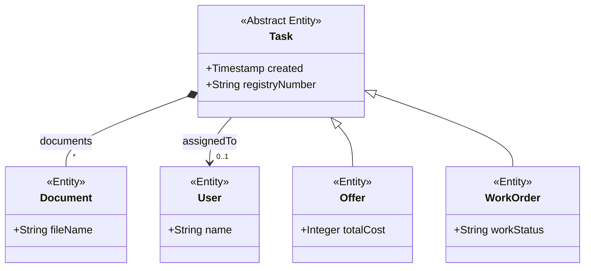

## Intent

Several entities share the same infrastructure: created and modified times, a registry number, documents, an assignee, a history. Declare it once on a base entity and let each concrete entity extend that base with its own fields.

## Practice

### What the platform provides

- Generalization is a platform feature between **entity** types. A subtype inherits every attribute and relation of its supertype ([model development guide](../../agent-docs/model/model-development.md), "Polymorphism with Inheritance"; [relation and class rules](../../agent-docs/model/esm_metamodel/structure.md)).
- Inheritance between transfer object types is **not** supported. Each transfer object maps one entity and declares its own members ([[transfer-generalization]]).
- A base entity can be marked abstract. An abstract entity cannot be created by itself, so a transfer object used for creation must map a concrete subtype ([model validation](../../agent-docs/model/model-validation-and-transformation.md); the generated DAO offers create only for mapped, non-abstract types: [data access guide](../../agent-docs/backend/data-access-guide.md)).
- When an access targets an abstract base, the generated UI offers the choice of concrete subtypes on create ([advanced modeling patterns](../../agent-docs/model/advanced-modeling-patterns.md), "Platform-Managed Polymorphic Creation"). Distinguish mixed subtypes in a list with separate view definitions per subtype.

### Practice note: what goes on the base

- Shared stored attributes (`created`, `modified`, `registryNumber`) and shared relations (`assignedTo`, `documents`, `history`).
- The base may carry shared operations, for example publish or delete, and a shared status ([[enum-state-machine]]).
- A subtype adds only what is specific to it.
- Abstract base when only the subtypes exist in practice; non-abstract when the base itself is also created, as some projects did with an `InterfaceSpecification` that is both a base and a concrete type.
- A shallow hierarchy (base plus one level) is the norm; one project went to two levels.
- Use it when the entities really are "is-a" variants. Use it for the shared plumbing of a workflow family, not for unrelated entities that happen to share two fields.

### Known pitfall

A derived attribute that navigates through a member inherited from a supertype can generate SQL with a missing join. It works when the member is declared locally ([known issues](../../agent-docs/model/model-validation-and-transformation.md), "Known issues"). Declare such navigation on the subtype, or avoid it, and test derived members that cross the inheritance line.

## Rationale

- One definition of the shared fields keeps the entities consistent, and the one place to add a shared field.
- Polymorphic queries and relations to the base reach all subtypes at once (a feed that points to the base type).
- Cost: hierarchy rules, all subtypes follow the base contract, and the generated code has the inherited-member pitfall above. The flat model avoids both ([[flat-entity-model]]).

## Example

A Task base entity (abstract) holds `created`, `registryNumber`, an `assignedTo` relation to User and a `documents` composition. Offer and WorkOrder extend Task; Offer adds a cost, WorkOrder a work status. The diagram shows the shape. Source projects used the same idea for work tasks (six subtypes), content posts (four subtypes), requests with shared approve and reject operations, credentials per external platform, and a two-level interface hierarchy. See [[post-generalization-hierarchy]], [[partner-generalization-hierarchy]], [[credential-generalization-hierarchy]] and [[interface-specification-generalization-hierarchy]]. Names here are neutral.

## When to avoid

- The entities only look similar: keep them flat ([[flat-entity-model]]).
- Variation is mostly in the UI or per role: use several transfer objects over one entity ([[transfer-generalization]]).
- Many derived attributes navigate through inherited members, and you cannot test the generated queries.

## Related

- [[flat-entity-model]]: the alternative without inheritance
- [[enum-state-machine]]: a shared status on the base
- [[transfer-generalization]]: transfer objects cannot inherit, so repeat the projections
- [[post-generalization-hierarchy]]: blueprint: abstract post base
- [[partner-generalization-hierarchy]]: blueprint: abstract partner base
- [[credential-generalization-hierarchy]]: blueprint: base with strategy subtypes
- [[interface-specification-generalization-hierarchy]]: blueprint: two-level hierarchy

## Structure diagram

<!-- mermaid:generated fragment=generalization-base-entity cli=1.1.0.20261108_202643_d9769d90_develop -->

<!-- /mermaid:generated -->
