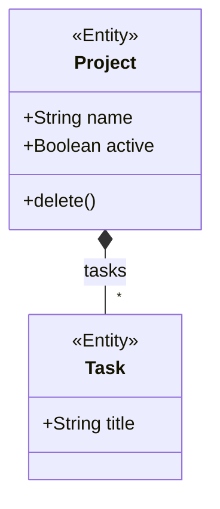

## Intent

Some entities may be deleted only in certain states (not active, no live roles, no dependent data). Put the preconditions at the top of an entity operation named `delete`, and let the operation clean up the dependent parts before it removes the entity.

## Practice

### Guard first, then clean up, then delete

An instance operation `delete` on the entity carries a JCL body (`customImplementation = false`, `stateful = true`; see [Operation script language (JCL)](../../agent-docs/model/jcl-operation-scripts.md) and [operation reference](../../agent-docs/model/esm_metamodel/operation.md)). The body has three steps:

1. Guard: `if (this.active) { return }`. Several flags can be joined with `or`, for example "has an active admin role or an active employee role".
2. Cleanup: `delete this.tasks` removes the composition parts. The `delete <navigation>` statement removes composition parts only; a plain association is cleared with `unset` or `-=` instead of `delete`.
3. Removal: `delete this` removes the entity itself.

The operation must be `stateful`: the DAO throws `IllegalStateException` for a write inside a stateless operation ([platform behaviour](../../agent-docs/model/esm_metamodel/operation.md), "Statefulness derived from behaviour").

### The guard is a convention, not platform behaviour

The platform gives `deleteable` flags on accesses and relations and cascades a parent delete over composition relations ([relation kinds](../../agent-docs/model/esm_metamodel/structure.md)). It has no declarative "delete only if" rule. The guard lives in the operation body, so an API client that uses the generated delete without the operation bypasses it. Expose deletion only through this operation (leave `deleteable` off on the accesses) when the rule must hold everywhere.

### Silent return versus a reported error

The original projects return without a message. The caller cannot tell that nothing happened. To report the reason, model a fault on the operation and throw it from a custom Java implementation: a custom operation that throws a business fault must declare it in `faults`, otherwise the build fails ([error handling guide](../../agent-docs/backend/error-handling-guide.md), "Modeled Faults"). The agent-docs describe no way to raise a fault from a JCL body, so a reported error means `customImplementation = true`.

### Mirror the guard in the UI

Expose the guard as a derived boolean (for example `deletable`) on the transfer object and bind the delete button to it ([[ui-control-transfer-fields]]). The operation still repeats the check because the UI flag is only a hint.

## Rationale

- The business rule sits in one place, next to the data it protects.
- The cleanup is explicit: nothing relies on an implicit cascade that has to be guessed from the model.
- Cost: a silent return hides the reason from the user. Accept that for internal tools, or pay for a custom implementation with a declared fault.

## Example

A Project entity has a boolean `active` and owns Task entities by composition. Its `delete` operation returns early when `active` is true; otherwise it deletes the tasks and then the project. The diagram shows the model shape; the operation body is described above. In the source project a User had the same guard over three role flags, and a second entity guarded on `active` also removed its child targets. Names here are neutral stand-ins.

## When to avoid

- The entity is never really deleted: use [[soft-delete-active-flag]] and keep the row.
- The only dependents are composition parts and there is no precondition: the platform cascade already removes them, no operation is needed.
- The user must see why deletion was refused and you do not want a custom Java implementation.

## Related

- [[soft-delete-active-flag]] — hide instead of delete
- [[mapped-operation-delegation]] — transfer objects reach the entity operation through a mapped operation
- [[ui-control-transfer-fields]] — derived booleans that drive the delete button

## Structure diagram

