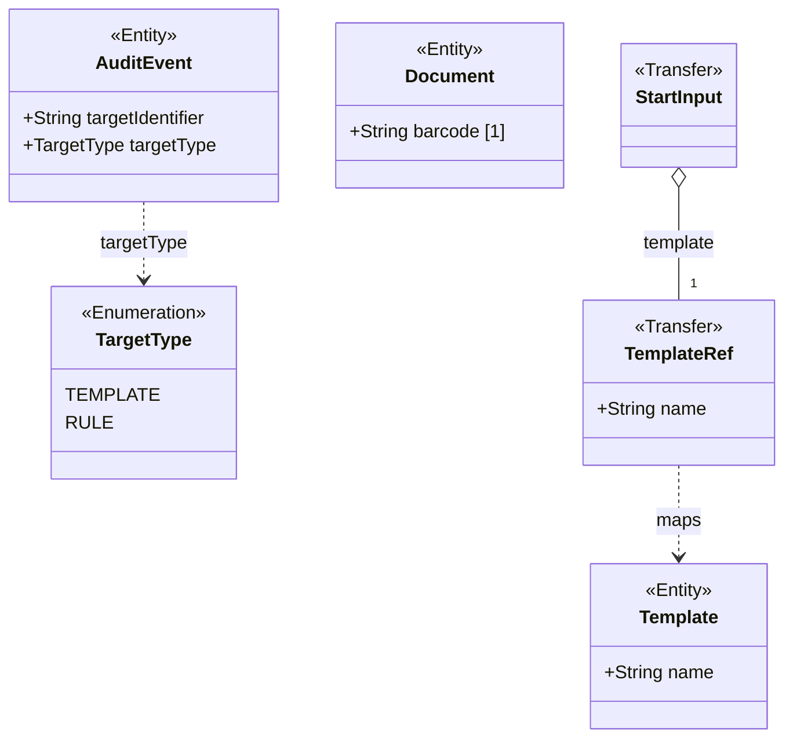

## Intent

Members named like `templateId` or `targetIdentifier` look the same in the model but fall into two groups. Some are real domain identifiers: business values with meaning beyond uniqueness. Others are strings standing in for what should be a typed relation. This rule says which to keep and which to replace.

## Practice

### Keep as an attribute when one of these holds

- **Business identifier:** the externally visible identity of the entity itself (a printed barcode, ISBN, invoice number). There is no other entity to relate to; the string is the thing. For generated codes see [[sequence-based-identifier]].
- **Opaque session token:** a system-issued handle whose only job is to retrieve its bearer (upload token, generation handle, OAuth state value).
- **Pre-allocated future identifier:** the value names something that does not exist yet when it is written (a barcode reserved at session start for a document created at confirmation). A relation cannot point at a missing target.
- **Polymorphic target:** the target's type varies. The relation target must be one class, so the shape is an identifier string plus a type enumeration. This gives up type safety to keep one log entity for mixed targets; the alternative is one log entity per target type. See [[audit-event-entity]].

### Replace with a relation when one of these holds

- **Input picker for an existing typed entity:** the value identifies a row the user picks. Declare a transient relation on the unmapped input transfer object, target a mapped transfer object, and cardinality exactly one. Choice and range lookups are generated per relation (`getRangeFor<Name>` operations, [platform behavior reference](../../agent-docs/backend/platform-behavior-reference.md), *Range and Choice Operations*), and a value outside the range is rejected with `NOT_ACCEPTED_BY_RANGE`. A string attribute gives you none of that. See [[transient-relation-single-select-input]] and [[transient-relation-parameter]].
- **Foreign key by string between two stored entities:** use a relation (an `ASSOCIATION`, with `COMPOSITION` where one owns the other, [structure reference](../../agent-docs/model/esm_metamodel/structure.md), *RelationKind Behaviour*). A string defers integrity checking to operation code.
- For an input in an API package, the target can be a thin reference transfer object; see [[api-package-thin-ref-projection]]. A transient relation on an unmapped transfer object has kind `AGGREGATION` (validator rule); the CLI cannot set that kind ([advanced modeling patterns](../../agent-docs/model/advanced-modeling-patterns.md), *Relation kinds per layer and the bidirectional rules*).

Project observations the agent-docs do not state (treat as *verify*): the React form renders a typed picker for such a relation but a plain text field for a string; with strings the operation had to look up each id itself and raise its own not-found faults.

### Triage

Review every member named `*Id`, `*Identifier`, `*Ref` or `*Uuid` against the lists above. Entity-level hits are usually legitimate domain identifiers; hits on input transfer objects are usually fixable. For each replace-hit, decide the target transfer object (existing or thin reference) first.

## Rationale

- A relation brings referential integrity and a generated picker; a string silently loses both.
- Wrapping a real business identifier in a relation invents an entity that does not exist, and loses the meaning of the value.
- Do not apply "no string ids" as a blanket rule.

## Example

The diagram shows both groups. A document keeps its barcode as an identifying string attribute. An audit event keeps a target identifier string plus a target type enumeration. A start input holds a transient relation to a template reference, instead of a string template id.

Observed in one project:

- Kept: the document barcode (BarcodeCode128 type), the generation handle's own id (opaque token), the handle's reserved document barcode (pre-allocated), and an LLM audit event's target identifier with a companion kind enumeration (polymorphic).
- Replaced: the start and confirm generation inputs had four transient String attributes (object, template, design, generation handle). The operations resolved each by lookup in custom Java and raised not-found faults by hand, and the form showed four plain text fields. Four transient one-to-one relations to mapped transfer objects replaced them, so the unresolvable references are rejected by the framework and the form shows typed pickers.

## When to avoid

- The identifier really is a business value, token, future value or polymorphic reference (the keep list): leave it as an attribute.
- A fully UI-internal input where reuse of an existing dashboard transfer object is simpler: the thin reference is optional (see [[api-package-thin-ref-projection]]).

## Related

- [[api-package-thin-ref-projection]] — reference transfer object for input pickers in an API package
- [[transient-relation-single-select-input]] — the relation shape that replaces a string id on an input
- [[audit-event-entity]] — polymorphic target identifier and type pair
- [[sequence-based-identifier]] — when the string identifier is the domain (generated codes, document numbers)

## Structure diagram

<!-- mermaid:generated fragment=identifier-attribute-vs-relation cli=1.1.0.20261108_202643_d9769d90_develop -->

<!-- /mermaid:generated -->
