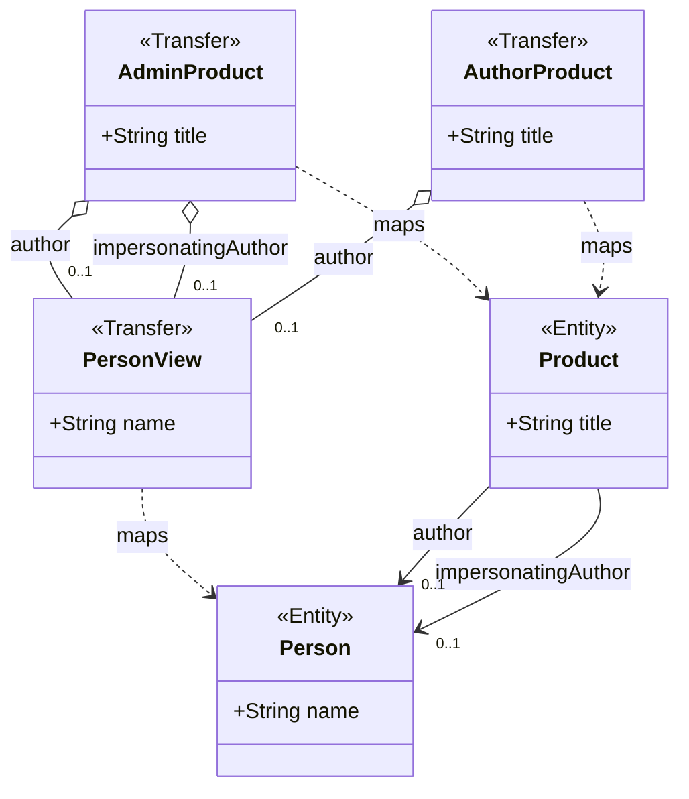

## Intent

An administrator sometimes creates content in the name of another user. Keep the true owner and the acting administrator apart: the entity has its normal ownership relation and a second, optional relation that records who impersonated.

## Practice

### Two one-way associations to the same target

- `author` (`0..1`, association): the owner. Normally the signed-in user.
- `impersonatingAuthor` (`0..1`, association): set only when an admin acts for someone else.

Both are stored, one-way relations to the same user entity (see [relation kinds](../../agent-docs/model/esm_metamodel/structure.md)). Neither needs a partner relation. The impersonation relation is optional so ordinary content leaves it empty.

### Fill the owner from the signed-in user

A relation of a transfer object or entity can carry a default expression. For a persisted actor (the actor's principal is a mapped transfer object over a stored entity) the expression reads the actor's data with `!getVariable('ACTOR', ...)`; for a token-only actor it would be `USER`. Pick the category deliberately: the wrong one returns empty values without a compile error ([ACTOR vs PRINCIPAL vs USER](../../agent-docs/model/advanced-modeling-patterns.md)). Project practice: the owner defaults to the current user, and the admin overwrites it and fills the impersonation relation explicitly. See [[actor-context-variable-lookup]].

### Expose it only on the admin transfer object

Each actor reaches the entity through its own transfer object ([[actor-based-transfer-projection]]). The admin transfer object maps both relations; the author's transfer object maps only `author`. Because a client can only send members that the transfer object contains, a normal author cannot set the impersonation relation. This is project practice built on the platform's per-actor access: the platform itself does not know the meaning of "impersonating".

## Rationale

- The real owner stays correct for queries such as "my products", while the audit view can still show who uploaded it.
- No actor switch or token exchange is needed: the relation is plain data.
- The model records the fact only. It does not check that the caller is an admin: the admin-only access and the exposure on the admin transfer object are the guard.

## Example

A Product has `author` and `impersonatingAuthor`, both pointing to Person. AdminProduct maps title, author and impersonatingAuthor. AuthorProduct maps title and author. In the source project an admin uploaded products in the name of a teacher. Names are neutral stand-ins.

## When to avoid

- Only one person ever acts on the entity: a single owner relation is enough.
- You need a full audit trail of every change and actor: use [[audit-event-entity]].
- Real impersonation of a session (acting as the user across the whole application) is a login concern, not a data relation.

## Related

- [[actor-context-variable-lookup]] — the owner is set from the actor context
- [[actor-based-transfer-projection]] — impersonation is exposed only on the admin transfer
- [[audit-event-entity]] — full change history instead of one extra relation

## Structure diagram

<!-- mermaid:generated fragment=impersonation-relation cli=1.1.0.20261108_202643_d9769d90_develop -->

<!-- /mermaid:generated -->
