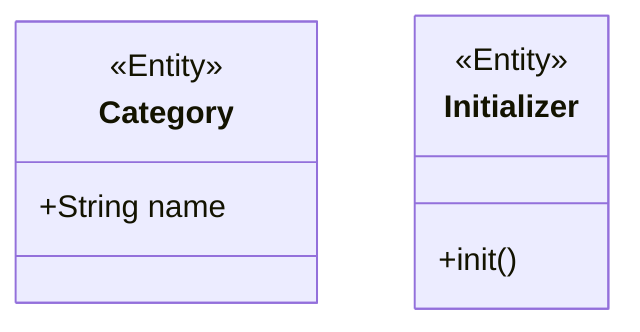

## Intent

A new deployment needs reference data and a first account. Model one initializer operation (or a few small ones) that creates them, and make each run safe to repeat.

## Practice

### What the platform defines

- An `INITIALIZER` operation is stored as a `STATIC` operation with the `initializer` flag; it must be static and take no input ([operation reference](../../agent-docs/model/esm_metamodel/operation.md), "INITIALIZER Special Handling" and "Operation naming and shape constraints"). It may sit on an entity or a transfer object, mapped or unmapped.
- It is `stateful` so it may write: a write in a stateless operation throws `IllegalStateException` ("Statefulness derived from behaviour" in the same reference).
- The body is a JCL script (`customImplementation = false`, see [JCL](../../agent-docs/model/jcl-operation-scripts.md)) or Java (`customImplementation = true`, see [custom operations](../../agent-docs/backend/custom-operations.md)).
- In the OSGi runtime the platform calls every initializer by itself when the model component activates, on every start, with an empty exchange (no principal, no `ACTOR`) and in its own transaction ([platform behavior reference](../../agent-docs/backend/platform-behavior-reference.md#initializer-operations)). The Spring Boot runtime is not verified; check there before relying on it. Backend seeding details: [[init-data-seeding]].

### Practice note: where it lives and how it is guarded

- Host: a dedicated entity (`Initializer`, `Application`) kept out of navigation, or an existing singleton entity ([[singleton-entity]]). Placing it on a domain entity also occurs but mixes concerns.
- Guard: begin with a check so a second run does nothing. Variants seen: `if (Category!empty())`, a count compared with zero, an `!exists(...)` check per record (per-record keys allow adding rows in later releases). The collection functions are JQL functions listed in the [model development guide](../../agent-docs/model/model-development.md).
- Create rows with `new Type(...)` that lists all required attributes and relations; attach children with `+=` on a reference set.
- Several small initializers (users, vendors, categories) read better than one large one.
- Large or conditional seeds: leave the body to a Java implementation ([[custom-implementation-placeholder]]).
- Do not read the actor: no user is signed in during seeding.

## Rationale

- Seed data is versioned with the model, so every environment starts equal.
- The guard makes the operation safe to call at each start.
- Cost: sample data in the model can leak into production; separate demo seeding from reference data.

## Example

An Initializer entity has the static operation `init` (initializer, stateful, no input). Its body creates the default Category rows only when no Category exists yet. The diagram shows the entity and the operation. Projects seeded users with role flags, categories, regions, reference catalogs, or whole demo data sets (periods, groups, items); several used a custom Java body instead of a script. Names here are neutral.

## When to avoid

- The data set is large or file-driven: import it instead (see [[init-data-seeding]]).
- Data must be changed on running systems: use versioned migration steps, not a repeated seed.
- Test data in production: keep it in a separate operation that is not called there.

## Related

- [[singleton-entity]] — dedicated host entity
- [[custom-implementation-placeholder]] — Java body for complex seeding
- [[init-data-seeding]] — backend side: DAOs, guards, runtime
- [[initializer-entity-with-init-operation]] — the blueprint for the host entity

## Structure diagram

