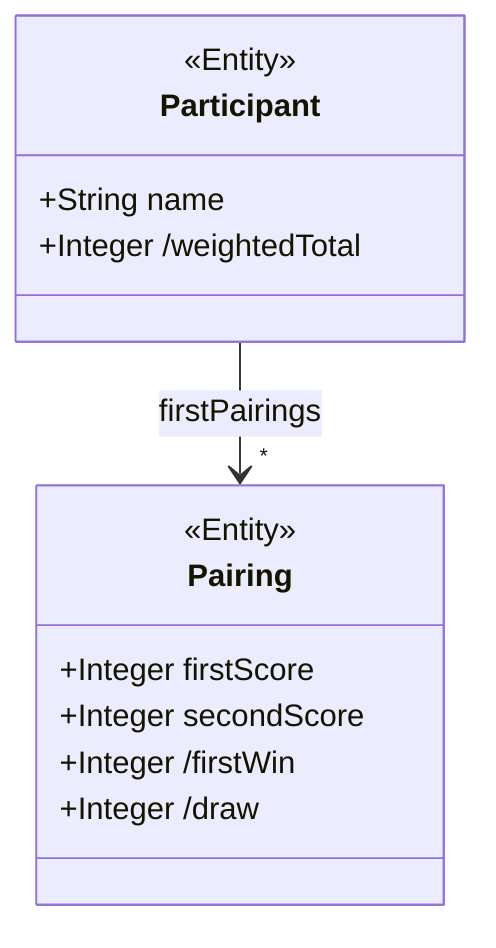

## Intent

A true/false condition per row has to be counted or weighted across a collection (for example, how many rows meet a condition, or a weighted total of such counts). In JQL `!sum` accepts only integer and decimal values, so a derived Boolean cannot be summed. Model the condition as a derived Integer that is 1 or 0.

## Practice

### Flag as a derived Integer with a ternary

On the entity, declare the flag as a derived attribute of type Integer:

```
firstWin: Integer = self.firstScore - self.secondScore > 0 ? 1 : 0
```

The ternary `cond ? then : else` needs a logical condition and branches of the same kind ([JQL grammar quirks](../../agent-docs/model/model-development.md)). The enclosing entity can then aggregate the flag:

```
weightedTotal: Integer = 3 * self.firstPairings!sum(m | m.firstWin) + self.firstPairings!sum(m | m.draw)
```

`!sum(i | selector)` works on integer and decimal selectors only; other types fail with `Invalid expression for aggregation` ([collection functions](../../agent-docs/model/model-development.md)). That is the platform fact behind this practice.

### Alternative that needs no flag

`self.pairings!filter(m | m.firstScore > m.secondScore)!count()` gives the same count without a flag attribute, and a Boolean attribute can be used there. Use integer flags when the flag is weighted or summed in several places, or when it should itself appear on a transfer object as a number.

### Take care with missing values

JQL propagates `undefined` through arithmetic and comparison, so a flag built from a missing score is `undefined`, not 0 ([undefined value](../../agent-docs/model/model-development.md)). Decide explicitly whether empty rows count as 0 and filter them out or default them. See [[null-safe-collection-aggregation]].

### Name and keep it internal

Name the flags as conditions (`firstWin`, `draw`). Keep them on the entity and map them only into transfer objects that need a number; a user-facing view normally wants a real Boolean.

## Rationale

- One flag definition is reused by every aggregate that needs it ([[derived-attribute-flattening]]).
- `!sum` over flags keeps the aggregate readable.
- Cost: 0/1 is less expressive than a Boolean, and any integer type check is lost. Document the meaning in the attribute documentation.

## Example

A Pairing has two scores and derived Integer flags `firstWin` and `draw`. A Participant has a relation to its first-side pairings and the derived `weightedTotal`, which sums the flags with weights 3 and 1. The diagram shows the shape. Names are neutral; the source project used a ranking table.

## When to avoid

- The condition is only shown, never summed: use a derived Boolean.
- A single count is enough: use `!filter(...)!count()`.
- Large collections where the derived flag is recomputed for each row on every read: consider a stored aggregate ([[aggregated-stored-field]]).

## Related

- [[derived-attribute-flattening]] — derived attributes that expose related data
- [[null-safe-collection-aggregation]] — handling empty and missing values in aggregates
- [[aggregated-stored-field]] — store the result instead of computing it

## Structure diagram

<!-- mermaid:generated fragment=integer-boolean-for-aggregation cli=1.1.0.20261108_202643_d9769d90_develop -->

<!-- /mermaid:generated -->
