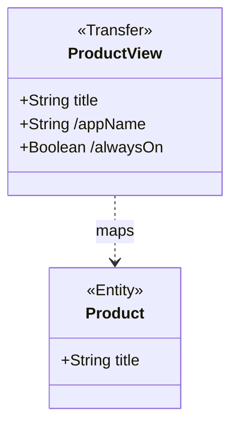

## Intent

Some values are the same for every row: an application name, a version label, or a boolean that must always be true or false so that a UI control stays permanently enabled or disabled. Expose them as a derived attribute whose getter expression is a literal.

## Practice

### Literal getter on a derived attribute

Declare a derived attribute (`memberType = DERIVED`) with a getter expression that is a constant: a quoted string such as `"Example Shop"`, or `true` / `false`. Nothing is stored and the owner needs no matching entity attribute. Derived attributes are read-only for clients.

- Put the constant on the transfer object when only one view needs it. The entity may have no such attribute.
- Put it on the entity when several transfer objects must expose the same constant.

### Boolean constants as UI switches

`hiddenBy`, `enabledBy` and `requiredBy` must reference a boolean data member of the same transfer object that owns the widget ([UI authoring guide](../../agent-docs/model/ui-authoring-guide.md), `hiddenBy` / `enabledBy` / `requiredBy`). When the control should be on or off unconditionally, an always-true or always-false derived attribute provides that boolean. This is a convention: the platform has no "constant" element for it. Prefer a real condition ([[ui-control-transfer-fields]]) wherever one exists, and remove the control when it can never be on.

### Do not confuse it with an access getter

An access getter on an actor (a derived access) must return a reference expression; a boolean literal there is invalid ([architectural patterns](../../agent-docs/backend/architectural-patterns.md), "Rules for `accesses[*].getterExpression`"). The literal belongs on a data member, not on an access.

## Rationale

- Constants reach clients through the normal transfer object, with no storage and no backend code.
- The expression is evaluated when read, so the value follows the model, not a database row.
- Cost: changing the value means changing the model and redeploying. Values that operators must change (a version label from a build, a configurable name) belong in configuration or data.

## Example

A ProductView transfer object maps a Product title and adds two derived attributes: `appName` with the literal `"Example Shop"`, and `alwaysOn` with the literal `true`, used as the boolean target of a widget's `enabledBy`. In the source projects the constants were an application name on a transfer object and several always-true or always-false flags, one of them defined on the entity. Names here are neutral.

## When to avoid

- The value changes at runtime or per environment: use stored configuration ([[singleton-entity]]).
- A genuine condition can drive the control: use [[ui-control-transfer-fields]].
- Mapping a stored attribute instead: see [[derived-attribute-flattening]].

## Related

- [[derived-attribute-flattening]] — derived attributes that read data
- [[ui-control-transfer-fields]] — fields that drive UI state from real conditions
- [[singleton-entity]] — stored, editable application settings

## Structure diagram

<!-- mermaid:generated fragment=literal-derived-attribute cli=1.1.0.20261108_202643_d9769d90_develop -->

<!-- /mermaid:generated -->
