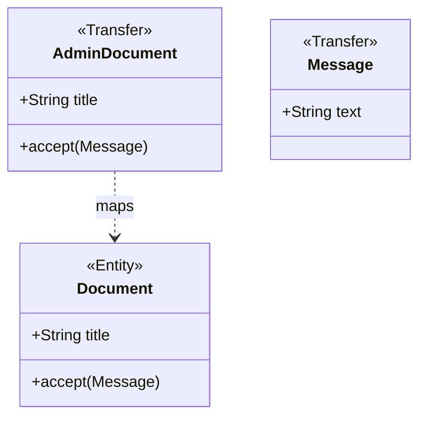

## Intent

Business logic belongs on the entity. Each actor still needs its own API surface. Define the operation once on the entity, and expose it on the actor's transfer object as a MAPPED operation that binds to it.

## Practice

### Entity operation plus MAPPED operation on the transfer object

- The entity holds an `INSTANCE` operation with the logic (a JCL body, or a custom Java implementation; see [JCL](../../agent-docs/model/jcl-operation-scripts.md) and [[custom-implementation-placeholder]]).
- A transfer object that maps the entity gets an operation of type `MAPPED`. Its `binding` is the name of the entity operation; candidates are the compatible operations of the mapped entity ([operation reference](../../agent-docs/model/esm_metamodel/operation.md), "Mapped Operation Rules"). `MAPPED` is only available on a mapped transfer object, never on an entity and never on an unmapped transfer object.
- The mapped operation has no body of its own. It is the entry point for the actor, the entity operation does the work.

### One entity operation, several transfer objects

Each actor sees its own transfer object ([[actor-based-transfer-projection]]). Expose the same entity operation on several transfer objects, and expose it only on the transfer objects of the actors who may call it. An operation missing from an actor's transfer object is not part of that actor's modelled API (the agent-docs do not describe other ways to reach it). The binding name may differ from the transfer operation name (a rename on the transfer side was seen in practice).

### Input, output and faults

Input, output and faults are parameters of the operation and are typed by transfer objects, so a mapped operation can use actor-specific types. Keep the signature compatible with the bound entity operation, or the mapping is invalid (the editor marks an invalid mapping). A custom implementation that throws a business fault must declare it in `faults` ([error handling](../../agent-docs/backend/error-handling-guide.md), "Modeled Faults").

### Statefulness and protection

A writing operation must be `stateful`; the DAO rejects writes in a stateless one ([operation reference](../../agent-docs/model/esm_metamodel/operation.md), "Statefulness derived from behaviour"). Interceptors do not fire for MAPPED, custom or script operations ([interceptors](../../agent-docs/backend/interceptors.md), "Which Operations Are Intercepted"; [custom operations](../../agent-docs/backend/custom-operations.md)). Check permissions and state inside the entity operation, and do not treat a hidden button as protection.

### Static operations are different

A static operation lives on the transfer object or entity itself and has its own body or custom implementation. It does not delegate.

## Rationale

- The logic exists once and every actor-specific API reuses it ([[toggle-operation-pattern]], [[guard-clause-delete]] are entity operations exposed this way).
- Actors receive tailored signatures without duplicating code.
- Cost: an extra declaration per transfer object, and the signatures must be kept in sync.
- The generated UI shows MAPPED operations as buttons on the view page or table rows ([screen layout](../../agent-docs/frontend/model-screen-layout.md), "Operation Types").

## Example

A Document entity has an instance operation `accept` with a Message input. The AdminDocument transfer object maps Document and declares a MAPPED operation `accept` bound to the entity operation with the same Message input. A second actor's transfer object could map the same operation or leave it out. Source projects used this for approve and reject operations, state toggles, and workflow transitions, with some operations exposed to several roles. Names are neutral.

## When to avoid

- The logic is only reachable from one actor and no entity-level reuse is needed: a static operation on the transfer object is simpler.
- Unmapped transfer objects: they cannot hold MAPPED operations.
- The entity operation has no implementation yet and only the transfer is wanted: model it as a [[custom-implementation-placeholder]].

## Related

- [[actor-based-transfer-projection]] — one transfer object per actor role
- [[custom-implementation-placeholder]] — Java body of the entity operation
- [[toggle-operation-pattern]] — a typical entity operation exposed this way
- [[guard-clause-delete]] — guarded delete exposed through a mapped operation

## Structure diagram

<!-- mermaid:generated fragment=mapped-operation-delegation cli=1.1.0.20261108_202643_d9769d90_develop -->

<!-- /mermaid:generated -->
