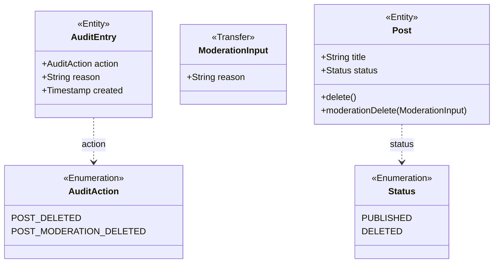

## Intent

Owners delete their own content. Moderators remove other people's content and must say why. Two operations keep the two paths apart: a plain `delete`, and a `moderationDelete` that takes a reason and records a different audit entry.

## Practice

### Two entity operations, one end state

- `delete`: instance operation without input, called by the owner. It records the ordinary audit entry (for example `POST_DELETED`).
- `moderationDelete`: instance operation with an input transfer object that has a `reason` attribute (an unmapped transfer object, see [[unmapped-transfer-dto]]). It records a moderation audit entry (`POST_MODERATION_DELETED`) with the reason.
- Both move the entity to the same final state, usually a `DELETED` status ([[soft-delete-active-flag]], [[enum-state-machine]]), or really delete it after writing the audit entry.

Both operations write, so both are `stateful` ([operation reference](../../agent-docs/model/esm_metamodel/operation.md), "Statefulness derived from behaviour"). The audit log is written inside the operation, in the same transaction as the delete ([[audit-event-entity]]).

### Who may call which

Expose `delete` through the owner's transfer object and `moderationDelete` only through the moderator actor's transfer object, each as a mapped operation ([[mapped-operation-delegation]], [[actor-based-transfer-projection]]). Do not rely on that alone: interceptors never fire for custom, MAPPED or script operations, so a role or ownership check must sit inside the operation implementation ([interceptors](../../agent-docs/backend/interceptors.md), "Which Operations Are Intercepted"; [custom operations](../../agent-docs/backend/custom-operations.md)). A moderation role check that must refuse the caller needs a declared fault when the operation is a custom Java implementation ([error handling](../../agent-docs/backend/error-handling-guide.md), "Modeled Faults"). The distinction of the two paths is project practice; the platform only provides operations, parameters and access exposure.

### Require the reason

Declare the reason attribute `required` on the input transfer object so that the generated input form asks for it. Check it again in the implementation: a client that calls the API directly is not bound by the form.

## Rationale

- The audit log tells apart "owner removed" from "moderator removed" and keeps the reason for accountability.
- Permissions stay simple because each operation is exposed to different actors.
- Cost: two operations per content entity. Share the removal code in one helper that both call.

## Example

A Post has a status (published or deleted) and two operations: `delete` and `moderationDelete(ModerationInput)`. ModerationInput carries `reason`. An AuditEntry entity has an action enum with two members, one per delete path, plus the reason and a timestamp. Both operations are custom implementations in this sketch. The source project had three content entities (news, offers, requests) with this pair, exposed through the company-admin service. Names are neutral.

## When to avoid

- Only one role ever deletes, or no reason is needed: a single `delete` is enough ([[guard-clause-delete]] for a guarded one).
- The audit log does not need the distinction: record the actor on one audit entry instead.
- Deleted content must be hidden, not changed: use a status and a filter ([[soft-delete-active-flag]]).

## Related

- [[audit-event-entity]] — distinct audit entries for the two paths
- [[enum-state-machine]] — both paths end in the deleted status
- [[soft-delete-active-flag]] — status-based delete keeps the moderated content
- [[mapped-operation-delegation]] — how each actor gets its own delete operation
- [[unmapped-transfer-dto]] — the reason input
- [[guard-clause-delete]] — preconditions on a plain delete
- [[actor-based-transfer-projection]] — one transfer object per actor

## Structure diagram

<!-- mermaid:generated fragment=moderation-operation-pattern cli=1.1.0.20261108_202643_d9769d90_develop -->

<!-- /mermaid:generated -->
