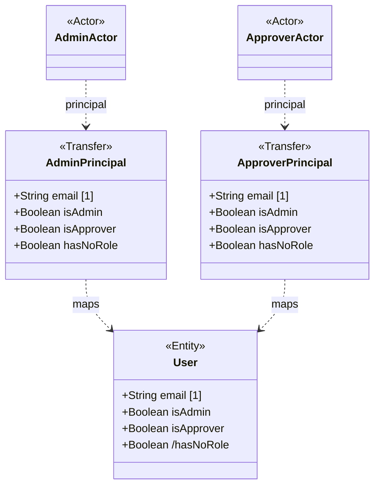

## Intent

Users have one identity but several roles, and one person may hold more than one. Keep a single user entity with a boolean flag per role. Each actor type is active only when its flag is true.

## Practice

### One entity, one principal transfer object per actor

- The user entity has stored boolean flags (`isAdmin`, `isApprover`), default false, and an identifier attribute that carries the login claim (for example the e-mail).
- Each actor type has a principal transfer object that maps the user entity. A `managed` actor needs a mapped principal and at least one claim of type `EMAIL` or `USERNAME` pointing at a mapped identifier attribute; otherwise the validator warns ([actor shapes](../../agent-docs/model/esm_metamodel/accesspoint.md), "Three actor shapes", "ActorType Attribute Rules"). In practice each actor needs its own principal transfer object over the shared entity.
- Each actor's `isActiveExpression` is a JQL expression that says whether this user may log in as that actor, for example `self.isAdmin`. The expression is evaluated on the principal row.
- All actors of the application use the same `realm` and the same claim, so one person logs in once and can reach each actor they hold.

### How the actor is chosen at login

The runtime derives the actor from the token's `azp` claim (dashes become dots and the result must equal the actor's FQN) and then reads the actor row on every request using the claim attribute (`USERNAME`, then `EMAIL`, then the first identifier) ([authentication guide](../../agent-docs/backend/authentication-guide.md), "Principal-to-Actor Resolution and Multi-Client Mapping"). Which frontend client belongs to which actor is therefore a deployment concern. Whether and how the runtime evaluates `isActiveExpression` is not spelled out in the agent-docs beyond "JQL expression returning true if actor can login"; test it on your runtime.

### Derived helper flags

Add derived booleans next to the stored flags: `hasNoRole = not (self.isAdmin or self.isApprover)`. For UI, a negated derived flag on the principal transfer object drives `hiddenBy` on menu items, because `hiddenBy` needs a boolean on the actor's principal and hides when it is true ([UI authoring guide](../../agent-docs/model/ui-authoring-guide.md), `hiddenBy` / `enabledBy` / `requiredBy`). Menu structure by role: [Advanced modeling patterns](../../agent-docs/model/advanced-modeling-patterns.md), "Dynamic Menu System for Multi-Level Permissions".

### Variants

- One generic actor for everyone plus derived flags for UI hiding.
- An enum role attribute when roles are mutually exclusive (an enum attribute, one value per user).
- Roles derived from data, such as `self.subordinates!count() > 0` for a manager role.

### Who assigns roles

An administrator toggles the flags through an admin transfer object. Protect the flag attributes: ordinary actors must not receive them as editable attributes ([[actor-based-transfer-projection]]). A user must not be able to remove the last admin flag: check this in the update path.

## Rationale

- One record per person, no duplication, any combination of roles.
- Role assignment is a simple switch.
- Cost: role data cannot be separate per role, filters have to be written per actor ([[derived-access-filtering]]), and the flags are plain data, so they are only as safe as the access rules around them.

## Example

A User entity has a unique e-mail, the flags `isAdmin` and `isApprover` (default false) and the derived `hasNoRole`. AdminActor and ApproverActor both use the same realm and an e-mail claim, each over its own principal transfer object, each active by its own flag. The source projects used three to five flags (admin, HR and professional flags; two administrator types; admin, architect, developer and operator roles). Names here are neutral.

## When to avoid

- Roles carry their own data: use separate entities or [[generalization-base-entity]].
- Roles are mutually exclusive: an enum role is clearer than several flags.
- Several independent identity providers per role: model separate actors with their own realms.

## Related

- [[actor-based-transfer-projection]] — one transfer object per actor over the shared entity
- [[default-value-patterns]] — flags default to false
- [[derived-access-filtering]] — per-role access filters
- [[generalization-base-entity]] — roles with their own data

## Structure diagram

<!-- mermaid:generated fragment=multi-role-single-entity cli=1.1.0.20261108_202643_d9769d90_develop -->

<!-- /mermaid:generated -->
