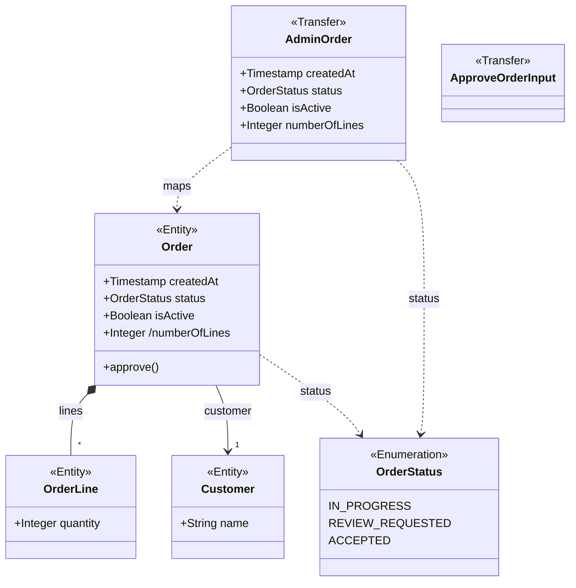

## Intent

Models are read for years by people who did not write them. Following one naming scheme makes element kinds recognisable from the name alone, and avoids the few names the platform and its generators reject.

## Practice

### What the platform fixes

These are platform rules; everything in the next section is project convention.

- Identifiers are ASCII letters and digits starting with a letter. A reserved word (`void`, `self`, `true`, `not`, ...) may be used as a name only when quoted with backticks in JSL ([JSL language rules](../../agent-docs/model/jsl-language-notes.md), "Identifiers and reserved words").
- An operation may not be named `set` or `get` plus an attribute or relation name (case-insensitive): those names belong to generated accessors ([operation reference](../../agent-docs/model/esm_metamodel/operation.md), "Operation naming and shape constraints").
- A transfer object that can be created through a relation or is the input of an operation gets a generated `getTemplate()`; a member named `template` on it collides and fails only at frontend build time. Rename the member and keep the binding ([generator reserved names](../../agent-docs/model/esm_metamodel/generator-reserved-names.md)).
- Do not use the double-underscore payload keys (`__identifier`, `__version`, ...) as feature names ([platform behaviour](../../agent-docs/backend/platform-behavior-reference.md), "Reserved Payload Keys").
- A name must be unique within its container: duplicate members are a validation error.

### Project conventions

| Element | Convention | Example |
|---|---|---|
| Entity | PascalCase, singular noun | `Order`, `OrderLine` |
| Attribute | camelCase, full words | `createdAt`, `numberOfLines` |
| Relation, many | camelCase plural | `lines` |
| Relation, one | camelCase singular, named for the role | `customer`, `homeTeam` |
| Operation | camelCase verb | `approve`, `approveAll`, `createOrder` |
| Enum type | PascalCase | `OrderStatus` |
| Enum member | UPPER_SNAKE_CASE | `IN_PROGRESS` |
| Package | short lowercase or the project's own consistent style | `entities`, `services`, `admin` |

Refinements seen in many projects:

- Boolean attributes: `is` or `has` prefix (`isActive`, `hasSkills`); a negated twin `isNot...` for hiding controls ([[ui-control-transfer-fields]]).
- Timestamps: `...At` suffix (`createdAt`, `expiresAt`); dates `...Date` or `dateOf...`.
- Flattened derived attributes: relation name plus attribute (`groupName`) ([[derived-attribute-flattening]]).
- Dual roles to the same entity: role names (`homeTeam`, `visitorTeam`) ([[dual-role-relation]]).
- Use the same enum member style within a model: most projects use UPPER_SNAKE_CASE, a few use camelCase.
- Toggle and lifecycle operations use verbs: `toggleActive`, `publish`, `reject` ([[toggle-operation-pattern]]).
- The domain language of the project may be any language; the case rules still apply.

### Transfer objects

- Repeat the entity name for the actor's projection and separate actors by package (`admin::Order`) or by a role prefix (`AdminOrder`, `AuthorProduct`) ([[actor-based-transfer-projection]], [[transfer-object-multiplicity]]).
- Mapped projections: suffix `Transfer` or `TO` when the project does not use packages.
- Unmapped input and output types ([[unmapped-transfer-dto]]): suffix by purpose: `Input`, `UpdateInput`, `Settings`, `Panel`, `Info`, `Data`.
- Choose one scheme per model and keep it. Mixing prefix and suffix styles is the most common inconsistency.

### Packages

Packages are model namespaces. Two layouts occur: one package for entities and one for services or actors, or one package per actor plus one for shared entities. Keep database entities and their API projections apart when both exist, and give shared types and measures their own package ([[standard-type-library]]).

## Rationale

- A reader can tell an entity from a projection, a flag from a status, a collection from a single relation.
- Generated code follows the model names, so API paths, SDK methods and UI labels inherit the same consistency.
- Cost: renaming later touches the model, custom Java code and translations. Choose names early. A rename on the transfer side only is possible through attribute binding ([[attribute-renaming-in-transfer]]).

## Example

An Order entity has an `OrderStatus` enum (`IN_PROGRESS`, `REVIEW_REQUESTED`, `ACCEPTED`), a `createdAt` timestamp, an `isActive` flag, a derived `numberOfLines`, a `lines` composition, a `customer` association and an `approve` operation. The transfer objects are `AdminOrder` (the admin's projection) and `ApproveOrderInput` (an input). The diagram shows the names only. The conventions come from about twenty source projects; the source models also used Hungarian names with the same case rules. These names are neutral.

## When to avoid

- An existing model with an established, different scheme: stay consistent with it instead of introducing a second one.
- Names imposed by an external API or a legacy schema: map them with transfer-level renaming and keep the model names clean.

## Related

- [[actor-based-transfer-projection]] — actor packages and prefixes
- [[transfer-object-multiplicity]] — several transfer objects per entity
- [[unmapped-transfer-dto]] — input and output suffixes
- [[attribute-renaming-in-transfer]] — rename on the transfer side
- [[standard-type-library]] — shared types package
- [[derived-attribute-flattening]] — relation plus attribute names
- [[dual-role-relation]] — role names for two relations to one entity
- [[toggle-operation-pattern]] — toggle verbs
- [[ui-control-transfer-fields]] — boolean twins for UI

## Structure diagram

