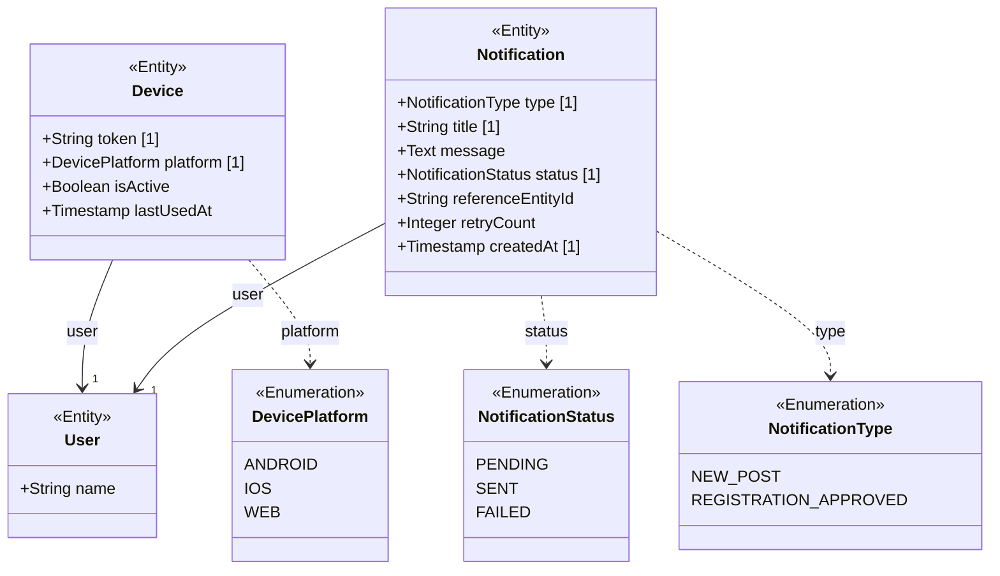

## Intent

Business events must reach users later, outside the request that caused them (push, e-mail). Store each notification as a row with a delivery status, so that a background job can deliver it and retry failures. Keep the device tokens of users in a companion entity.

## Practice

### Notification entity: system-written, read-only for clients

- Attributes: `type` (category enum for the trigger event; the members are per content kind), `title`, `message`, `status` (enum, for example PENDING, SENT, FAILED; the member set is an example, not fixed, see Variations), `referenceEntityId` (optional plain string, not a relation), `retryCount`, `createdAt`.
- Relation `user` to the recipient, required (`1..1`), a plain association: the notification does not own the user. Make it two-way ([[bidirectional-relation]]) only if the recipient's view must list notifications.
- Switch the entity's `createable`, `updateable` and `deleteable` flags off ([CRUD flags](../../agent-docs/model/README.md), "CRUD Flags"). That removes the generated create, edit and delete controls. These flags govern the generated API and UI only. They do not stop your own backend code, which writes rows through the generated DAO.
- Notifications are created as a side effect of business operations (publish, approve, receive an inquiry). The creating operation is a stateful operation ([operation reference](../../agent-docs/model/esm_metamodel/operation.md), "Statefulness derived from behaviour") or Java using the DAO.

### Status as a small state machine

PENDING after creation; a delivery job moves it to SENT or FAILED; a retry returns FAILED rows to PENDING and bumps `retryCount` ([[enum-state-machine]]). The model holds only the data. The delivery job and the external push service are backend work (see the push notification blueprint: [[firebase-push-notification-pipeline]]). The agent-docs describe no built-in notification mechanism, so everything about delivery is a convention.

### Device entity

Stores one external token per user device: `token`, `platform` (category enum, [[category-enum-pattern]]: ANDROID, IOS, WEB), an active flag, last-used timestamp, and a required relation to the user. It is system-managed: registered and deactivated by backend code. Mark tokens inactive instead of deleting them when the push service reports them invalid, if you want history ([[soft-delete-active-flag]]).

### Reference, not relation

`referenceEntityId` is a string, so a notification survives when the content is deleted. The cost is that the link to the content is not checked by the model.

### Variations

- **Inbox-only delivery state.** Add a status such as DELIVERED_INBOX_ONLY for a notification whose push failed but which the in-app inbox still shows. Whether such a row is retried is project logic. One project uses this next to PENDING, SENT and FAILED.
- **Type per content kind.** The type enum lists one member per kind of content or event, so the set differs from project to project.

## Rationale

- Delivery is decoupled from the user's request: failures do not break business operations.
- Status and retry count make delivery observable and repeatable.
- Cost: an extra write per event, a job to run and monitor, and no referential integrity to the source content. Old rows grow without bound unless a cleanup job removes them.

## Example

A Notification (type, title, message, status, reference id, retry count, created time) belongs to a User; a Device (token, platform, active flag, last used time) also belongs to a User. The enums are NotificationType, NotificationStatus and DevicePlatform. The source platform had eight notification types (new post, registration approved or rejected, invitation events and so on) and an FCM token per device. A second project kept only an e-mail notification with a delivered flag and a read flag set by a mark-as-read operation, without devices. Names here are neutral.

## When to avoid

- Notifications are sent immediately and never tracked: no entity needed.
- Only an in-app inbox with read marks is needed: see [[notification-entity]] for the lightweight blueprint and [[custom-notification-card-inbox]].
- A complete change history is wanted: use [[audit-event-entity]].

## Related

- [[enum-state-machine]] — delivery status transitions
- [[category-enum-pattern]] — notification type and device platform
- [[bidirectional-relation]] — recipient to notifications
- [[audit-event-entity]] — event history instead of delivery tracking
- [[soft-delete-active-flag]] — deactivate tokens instead of deleting
- [[notification-entity]] — blueprint for the plain notification entity
- [[firebase-push-notification-pipeline]] — backend delivery blueprint

## Structure diagram

